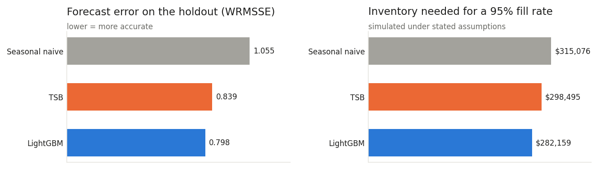
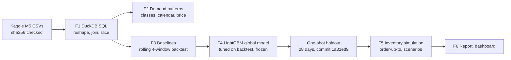
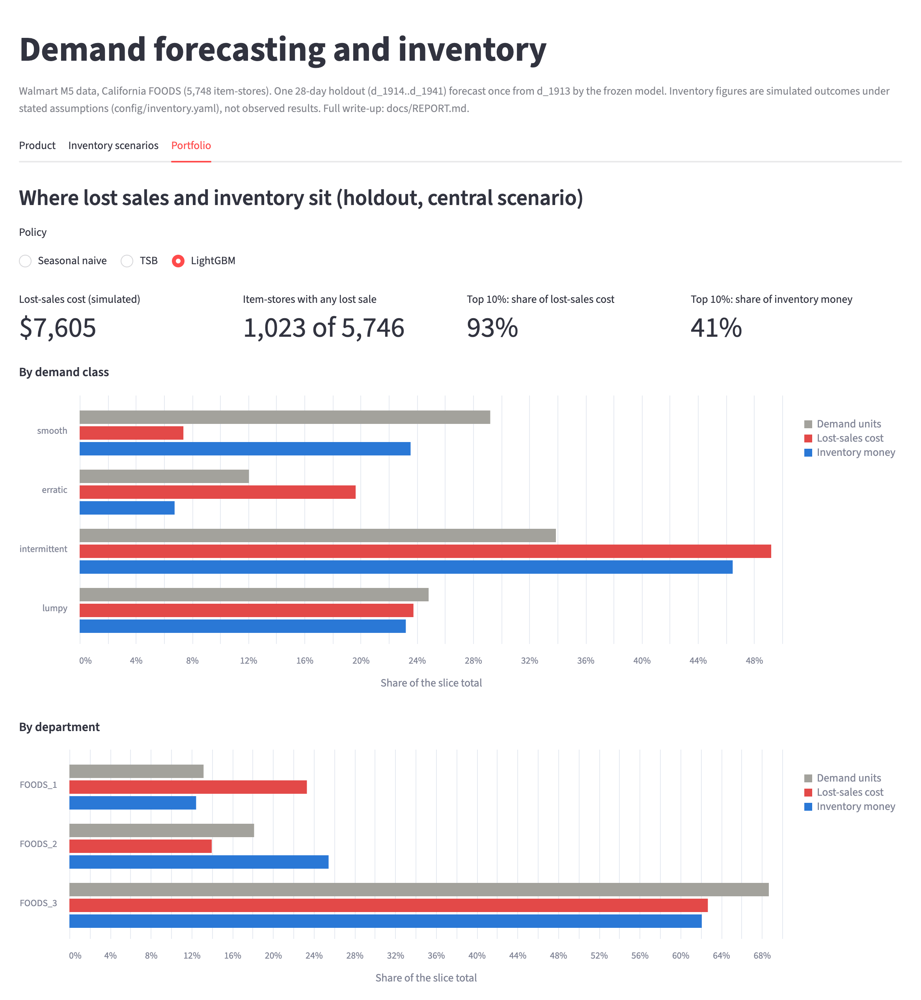

<!-- Generated by `python -m forecast.run_f6` from docs/templates/README.md. Do not edit by hand. -->
# Demand forecasting and inventory planning (Walmart M5)

How much of each product should a grocery store keep on the shelf? This project forecasts daily
demand for 5,748 Walmart item-store series (CA FOODS, M5 data), compares
a machine-learning model with the simple rules a store might use today, and turns each forecast into
an ordering policy to see what it means for stock and lost sales. The model and every rule are judged
on 28 days they never saw, scored once from a frozen commit, and every inventory figure is a simulated
outcome under stated assumptions.

**Read the findings:** [docs/REPORT.md](docs/REPORT.md) · **Explore:** `streamlit run app/streamlit_app.py`
(needs your own Kaggle download, see Reproduce)



## Results (holdout: 2016-04-25 to 2016-05-22, scored once)

| Method | Holdout WRMSSE | Backtest WRMSSE | Fill rate at the 95% target | Inventory needed for 95% fill |
|---|---|---|---|---|
| Seasonal naive (same weekday last week) | 1.055 | 1.112 | 95.9% | $315,076 |
| TSB | 0.839 | 0.873 | 95.8% | $298,495 |
| **LightGBM (global model)** | 0.798 | 0.831 | 95.7% | $282,159 |

WRMSSE: revenue-weighted, scaled forecast error per item-store (lower is better). Inventory: average
stock value the ordering policy needs to serve 95% of units, simulated on the holdout with
safety stock sized from backtest errors (lead time 2 days, weekly review).

## Key findings

1. **Most items sell intermittently.** 91% of item-stores are not "smooth"; a typical
   item sells on about one day in 2.1.
2. **The model beats simple rules by a stable margin:** 4.8% less error than TSB on the holdout
   (4.9% less in the backtest), and better than "same weekday last week" on 93% of
   items. It under-forecasts total demand (3.3% to 7.0% low a week).
3. **The calendar is associated with large swings** (weekends +19% / +23%, SNAP days
   +10.5%, Thanksgiving -25%). Price effects cannot be measured cleanly: M5 prices
   only change in weeks with sales.
4. **At an equal 95% fill rate the model-based policy needs 5.5% less inventory than TSB
   and 10.4% less than seasonal naive** (simulated). The direction holds on a pre-holdout window and in all 20 assumption scenarios; ranked by total cost at a fixed target, the order changes in
   4 of 20.
5. **Lost sales are concentrated:** the top 10% of item-stores carry 93% of the
   lost-sales cost; intermittent items carry 49% of it for 34% of demand.

## How it works



| Step | Code | Write-up |
|---|---|---|
| F1 Data and SQL | `src/forecast/run_f1.py`, `sql/` | [docs/F1_data_and_sql.md](docs/F1_data_and_sql.md) |
| F2 Demand patterns | `src/forecast/run_f2.py` | [docs/F2_demand_patterns.md](docs/F2_demand_patterns.md) |
| F3 Baselines and backtest | `src/forecast/run_f3.py` | [docs/F3_baselines_backtest.md](docs/F3_baselines_backtest.md) |
| F4 Model and holdout | `src/forecast/run_f4.py`, `run_f4_holdout.py` | [docs/F4_model_backtest.md](docs/F4_model_backtest.md), [docs/F4_holdout.md](docs/F4_holdout.md) |
| F5 Inventory | `src/forecast/run_f5.py` | [docs/F5_inventory.md](docs/F5_inventory.md) |
| F6 Report, dashboard, check | `src/forecast/run_f6.py`, `app/streamlit_app.py` | [docs/REPORT.md](docs/REPORT.md), [docs/F6_reproducibility.md](docs/F6_reproducibility.md) |

## Dashboard

`streamlit run app/streamlit_app.py` opens three views: **Product** (one item's history, holdout
actuals, the model and baseline forecasts with a band from its backtest errors; needs your own
Kaggle download), **Inventory scenarios** (pick among the pre-computed F5 scenarios, or replay one item
live) and **Portfolio**, shown here. It shows aggregates from `results/` only:



## Reproduce

Python 3.13; the full run was checked on an 8 GB MacBook (see
[docs/F6_reproducibility.md](docs/F6_reproducibility.md)).

1. **Get the data.** Sign in to Kaggle, accept the rules of the
   [M5 Forecasting - Accuracy](https://www.kaggle.com/c/m5-forecasting-accuracy) competition, download
   the data and put `sales_train_evaluation.csv`, `calendar.csv` and `sell_prices.csv` in `data/raw/`.
   Every run checks their sha256 against `config/raw_files.yaml` (sales: `4b4a47c44c38380d...`).
2. **macOS only:** LightGBM needs the OpenMP runtime: `brew install libomp`.
3. **Install and run** (F4 takes about 40 minutes; the others seconds to a minute or two):

```bash
python3 -m venv .venv
.venv/bin/pip install -r requirements.txt && .venv/bin/pip install -e .
.venv/bin/python -m forecast.run_f1
.venv/bin/python -m forecast.run_f2
.venv/bin/python -m forecast.run_f3
.venv/bin/python -m forecast.run_f4
```

4. **The holdout forecasts.** `results/f4_holdout.json` is committed and `forecast.run_f4_holdout`
   refuses to score the holdout a second time. Its per-item forecasts (needed by F5 and the dashboard)
   are not committed, because they contain item-level sales. Rebuild them by running the frozen code
   of commit `1a31ed9` in a separate scratch clone (`.tmp/` is gitignored); nothing in
   your working copy changes:

```bash
git clone . .tmp/holdout-1a31ed9 && git -C .tmp/holdout-1a31ed9 checkout 1a31ed9
mkdir -p .tmp/holdout-1a31ed9/data/processed
cp -R data/raw .tmp/holdout-1a31ed9/data/raw
cp data/processed/m5_slice.parquet .tmp/holdout-1a31ed9/data/processed/
(cd .tmp/holdout-1a31ed9 && PYTHONPATH=src ../../.venv/bin/python -m forecast.run_f4_holdout)
cp .tmp/holdout-1a31ed9/data/processed/f4_holdout_forecasts.parquet data/processed/
```

5. **Inventory, report and tests:**

```bash
.venv/bin/python -m forecast.run_f5
.venv/bin/python -m forecast.first_sale_week
.venv/bin/python -m forecast.run_f6
.venv/bin/python -m pytest && .venv/bin/python -m pytest -m realdata
.venv/bin/streamlit run app/streamlit_app.py
```

The dashboard's inventory and portfolio views work from the committed `results/` alone; the product
view needs `data/processed/` from the steps above.

## Data and terms

Data: M5 Forecasting competition (Walmart; University of Nicosia / MOFC), hosted on Kaggle. The
competition rules (checked 2026-10-14) allow competition, academic and non-commercial use and do not
allow redistribution. So `data/raw/` and `data/processed/` are never committed; `results/` holds
aggregated results only, and the dashboard runs locally on your own download.

Code: MIT licence ([LICENSE](LICENSE)). The licence covers the code in this repository only, not the
M5 data.

## Assumptions

All in `config/`, each with a written reason. The inventory ones are judgement calls, not in the data:

| Assumption | Central | Range tested | Reason (config/inventory.yaml) |
|---|---|---|---|
| Lead time (days) | 2 | 1, 2, 4, 7 | Store replenishment of grocery lines from a regional distribution centre usually takes 1-3 days; 2 is the middle. 4 and 7 stand for slower direct-from-supplier lines (TO VERIFY: Walmart's actual lead times are not in the data). |
| Review period (days) | 7 | 1, 3, 7, 14 | A weekly order per item is the textbook periodic-review case and matches the weekly cycle in the data (F2). 1 and 3 stand for fast fresh lines ordered daily or twice a week, 14 for slow lines. |
| Holding cost (share of price per year) | 0.25 | 0.15, 0.25, 0.4 | Share of the item's price per year of holding one unit (capital, space, handling, shrink); 20-30% is the usual textbook range, 15-40% the sensitivity. Per unit-day = rate x price / 365, charged on stock on hand at the end of each measured day. Perishability is not included (see above). |
| Cost of a lost sale (share of price) | 0.25 | 0.1, 0.25, 0.5, 1.0 | Cost of one lost unit as a share of its price, a proxy for the lost gross margin (US grocery gross margins are roughly 25%; TO VERIFY). 10% = thin margin, 50% and 100% add lost goodwill or the rest of the basket. |
| Unmet demand | lost sales | lost sales, backorders | A grocery shopper who finds an empty shelf buys a substitute or shops elsewhere, so unmet demand is lost. Backorders (the shopper waits; the shortfall is served from the next delivery) are run only as a sensitivity check, with the same cost per short unit. |
| Starting stock (x order-up-to level) | 1.0 | 0.5, 1.0, 1.5 | Day 1 starts with on-hand stock = factor x the order-up-to level S of the first review (rounded up), nothing on order: "as if the policy had already been running". 0.5 starts short, 1.5 starts overstocked, to show how much the first weeks depend on it. |
| Target cycle service level | 95% | 50.0%, 70.0%, 80.0%, 85.0%, 90.0%, 95.0%, 97.0%, 98.0%, 99.0%, 99.5% | Target cycle service level = chance that an order cycle has no lost sale; z is its standard normal quantile. 95% is a common retail target. The sweep (50-99.5%) draws the whole inventory vs fill rate curve; 50% means no safety stock beyond the bias term. |

## Limitations

- One 28-day holdout from a single forecast day; the inventory simulation covers 3
  weekly reviews.
- The model under-forecasts total demand (4.9% low on the holdout total).
- Achieved cycle service is about 91.8% against a 95% target: the normal safety factor
  under-covers skewed, intermittent demand.
- Cost and lead-time assumptions are judgement calls; money figures are simulated outcomes.
- Price and event effects are associations; the SNAP lift cannot be separated from other early-month
  income; M5 prices change only in weeks with sales.
- M5 records sales, not demand: days with an empty shelf hide lost demand.

## How it was built

I set the questions, scope, evaluation design and business assumptions, and reviewed each milestone
before the next. The code was written with Claude Code, an AI coding assistant, under fixed rules:
tests first, no hand-typed numbers in any document (they are rendered from `results/`), assumptions in
`config/` with a reason, and the holdout scored once from a frozen commit. Decisions and open
questions are logged in `NOTES.md`, progress in `PROGRESS.md`.

## Author

Aradhya Chandra, B.Tech Computer Science and Engineering, SNU (2024-2028).
