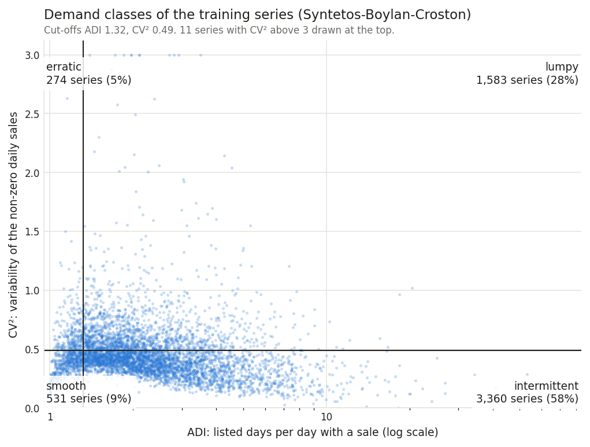
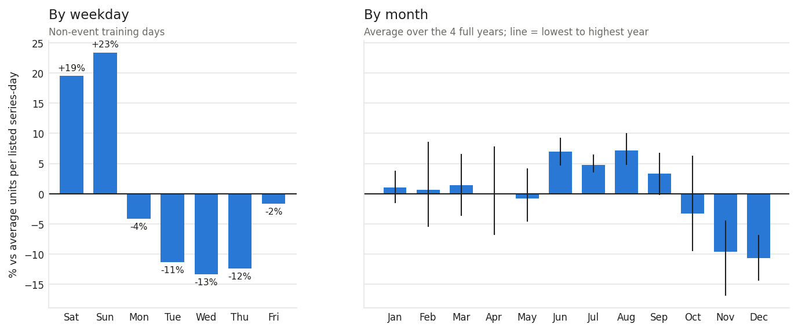
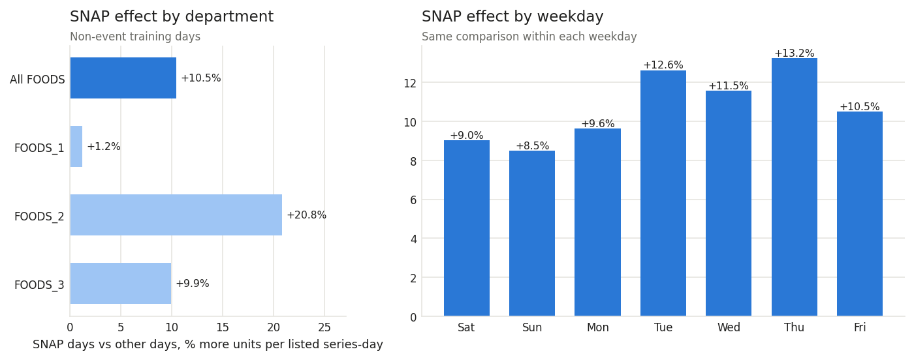
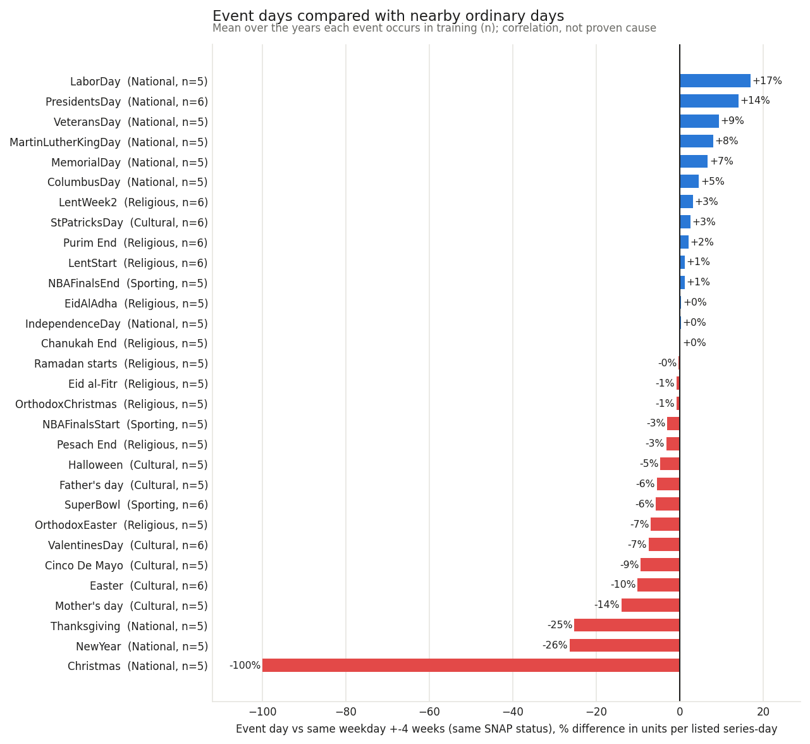
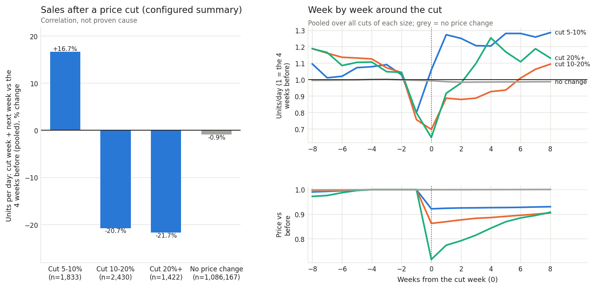

# F2: Demand patterns

*Generated by `python -m forecast.run_f2` from `results/f2_demand_patterns.json`. Do not edit the
numbers by hand.*

## What this step does, in plain words

Before forecasting, F2 asks how demand behaves. It looks at how often each product sells, which weekdays
and months sell more, what SNAP food-benefit days, holidays and price cuts go with, and how the products
split into the standard "demand classes" that decide which forecasting method suits them.

**Data used:** only the training days, d_1 to d_1913 (2011-01-29 to 2016-04-24). The
last 28 days are the final holdout (`config/holdout.yaml`), and F2 never reads them. Only
days on which the item was listed count: 8,423,403 series-days of 5,748 series,
19,196,302 units sold. Days before an item was listed are "not on sale", not zero demand (F1). Every
setting below is in `config/demand_patterns.yaml`, each with its reason.

**About the price and event results:** these are correlations under the stated comparison, not proven
causes. Shops plan promotions, stock and displays around holidays and price changes, and none of that
is in the data. So "sales were X% higher on event days" means exactly that, not "the event caused X%".

## 1. How predictable is demand? Demand classes

Each series is classified with the Syntetos-Boylan-Croston scheme, using two numbers:
- **ADI**: listed days per day with a sale. 1.0 means it sells every day; 3.0 means one day in three.
- **CV²**: how much the sales on selling days vary (squared coefficient of variation, sample variance).

The cut-offs are ADI 1.32 and CV² 0.49; a value exactly on a cut-off counts as high.

| Class | Meaning | Series | Share of series | Share of units |
|---|---|---|---|---|
| smooth | sells most days, steady amounts | 531 | 9.2% | 33.6% |
| erratic | sells most days, amounts swing | 274 | 4.8% | 16.6% |
| intermittent | many days without a sale, steady amounts | 3,360 | 58.5% | 26.5% |
| lumpy | many days without a sale, amounts swing | 1,583 | 27.5% | 23.3% |
| too_few_sales | fewer than the minimum days with a sale | 0 | 0.0% | 0.0% |



| Department | Smooth | Erratic | Intermittent | Lumpy | Too few sales |
|---|---|---|---|---|---|
| FOODS_1 | 29 | 59 | 403 | 373 | 0 |
| FOODS_2 | 99 | 10 | 1,241 | 242 | 0 |
| FOODS_3 | 403 | 205 | 1,716 | 968 | 0 |

**Plain reading:** 91% of the series are not smooth. A typical (median) series sells
on about one listed day in every 2.1. Across all series, 52% of listed series-days have a
sale. The 9% of series that are smooth sell 34% of all units. So
the fast movers carry much of the volume, while most of the product list is intermittent. For F3
this means:
- a Croston-type baseline is needed next to the moving averages;
- errors must be scaled per series (RMSSE-style), because plain averages would be dominated by a few
  fast movers;
- results should be reported per demand class.

## 2. Weekday and month

Measure: units per listed series-day (total units divided by the number of series on sale), on days
without an event. Using a rate stops the figures moving just because more items were listed.



- **Weekday:** Sunday +23%, Saturday +19%, Friday -2%, Monday -4%, Tuesday -11%, Thursday -12%, Wednesday -13% vs the average day. The weekend peak is the strongest regular pattern in the data.
- **Month:** highest Aug +7%, Jun +7%, Jul +5%; lowest Oct -3%, Nov -10%, Dec -11%. These are averaged over the full years 2012, 2013, 2014, 2015, each month relative
  to its own year, so growth and the partial first and last years do not distort them. The month
  pattern is much weaker than the weekday pattern, and the spread between years (black lines) is
  wide.

**Sales by year:**

| Year | Training days | Series on sale per day | Total units per day | Units per listed series-day |
|---|---|---|---|---|
| 2011 | 337 | 2,887 | 8,042 | 2.79 |
| 2012 | 366 | 3,612 | 10,227 | 2.83 |
| 2013 | 365 | 4,330 | 10,454 | 2.41 |
| 2014 | 365 | 5,062 | 10,517 | 2.08 |
| 2015 | 365 | 5,589 | 10,362 | 1.85 |
| 2016 | 115 | 5,747 | 11,359 | 1.98 |

The rate per listed series falls over the years, but total units per day do not fall the same way
(table). The number of items on sale grows, and the items added later mostly sell slowly, which pulls
the average per item down. Partial years: 2011 starts on 29 January, and 2016 stops at the holdout.

## 3. SNAP days

In California, SNAP food benefits are paid on the 1st to 10th of each month. On non-event days, units
per listed series-day were **10.5% higher on SNAP days** (2.44 vs 2.21, over
578 SNAP and 1,181 other days).



| Department | SNAP-day lift |
|---|---|
| FOODS_1 | +1.2% |
| FOODS_2 | +20.8% |
| FOODS_3 | +9.9% |

The lift appears on every weekday (from +8.5% to +13.2%), so it is not a weekday-mix
effect. It is also a correlation: the 1st to 10th of the month is when many wages and other benefits
arrive too, and this comparison cannot separate SNAP from that early-month effect. For forecasting,
it does not matter which one is the cause; the SNAP flag is a useful, known-in-advance feature.

## 4. Events and holidays

Each event day is compared with the same weekday 1 to 4 weeks before and after. Those
comparison days must have the same SNAP status and must not be event days themselves. The figure shows
the mean over the 158 event occurrences in training (154 event days; per-event
detail in `results/f2_event_effects.csv`, one row per occurrence in
`results/f2_event_occurrences.csv`).



Highest and lowest:

| Event | Type | Years | Mean difference | Lowest year | Highest year |
|---|---|---|---|---|---|
| LaborDay | National | 5 | +17.0% | +9.2% | +23.6% |
| PresidentsDay | National | 6 | +14.1% | +8.8% | +18.9% |
| VeteransDay | National | 5 | +9.3% | -4.9% | +17.5% |
| MartinLutherKingDay | National | 5 | +8.0% | +0.4% | +19.4% |
| MemorialDay | National | 5 | +6.7% | +2.8% | +12.7% |
| Easter | Cultural | 6 | -10.1% | -20.8% | -0.2% |
| Mother's day | Cultural | 5 | -14.0% | -23.5% | -5.8% |
| Thanksgiving | National | 5 | -25.3% | -30.4% | -19.2% |
| NewYear | National | 5 | -26.4% | -42.1% | -17.0% |
| Christmas | National | 5 | -99.9% | -99.9% | -99.9% |

**Plain reading:**
- Christmas shows about -100%: almost no sales, so the stores were essentially closed.
- Thanksgiving (-25%) and New Year (-26%) sell much less than nearby ordinary days.
- The Monday federal holidays sell more: Labor Day +17%, Presidents' Day +14%,
  Memorial Day +7%. People are off work, so a holiday Monday looks more like a weekend day.
- Most religious and cultural events are within a few percent of zero, and they vary from year to
  year (see the lowest and highest year).

By event type (mean over occurrences): Cultural -6.8% (n=38); National -8.7% (n=51); Religious -0.4% (n=53); Sporting -2.7% (n=16).

These are day-level differences. Pre-holiday stocking-up (for example the days before Thanksgiving)
falls on ordinary days and is not measured here.

## 5. Price cuts

A **price cut** is a week-on-week drop of at least 5%, after 4 full weeks at one
unchanged price. The **effect** compares units per day in the cut week and the next week with those 4
weeks. As a reference, the same comparison is run on stretches where the price did not change at all.

| Cut size | Cuts | Series | Change in units/day (pooled) | Median per-cut ratio | Price still down next week |
|---|---|---|---|---|---|
| 5-10% | 1,833 | 1,295 | +16.7% | 1.00 | 97% |
| 10-20% | 2,430 | 1,554 | -20.7% | 0.78 | 95% |
| 20%+ | 1,422 | 739 | -21.7% | 0.65 | 83% |
| all cuts | 5,685 | 2,736 | -12.8% | 0.86 | 92% |
| no price change (reference) | 1,086,167 windows | 5,748 | -0.9% | 0.97 | n/a |



**Plain reading:** the simple before/after numbers are **not** a clean price effect, and they should
not be quoted as one. The week-by-week picture (right) shows why. For every cut size, sales sag in
the week before the cut, before the price has changed: in week -1 they are at 0.80 (5-10%), 0.76 (10-20%), 0.80 (20%+) of the
before-level. A data check points to a likely part of the explanation:

> In full weeks with no sales, the price changed in 9 of 221,569 weeks. In weeks
> with sales, it changed in 1.9% of weeks (18,982 of 974,384).

So in M5 a new price shows up only in a week in which the item sells. This is consistent with the
weekly price being worked out from actual sales and carried forward through weeks without sales. The
data guide's exact wording is to be checked (NOTES.md, TO VERIFY). It means:
- the "cut week" is partly chosen by sales: it is the first week with a sale at the new price;
- slow weeks just before the cut keep the old price, which can produce the week -1 dip.

For cuts of 10% or more the dip continues into the cut week itself, and the check above does not
explain that. Possible reasons, none visible in the data: the shelf was empty for a while, or the
product was reset (new pack or size) at the same time as the price change.

After the cut the pattern differs by size. Small cuts (5-10%) are followed by sales above the before-level
in weeks 2 to 8 (1.21 to 1.29 of the before-level). Larger cuts recover more unevenly (10-20%: 0.88 to 1.09 of the before-level; 20%+: 0.98 to 1.25 of the before-level in weeks 2
to 8). Most cuts last: in 92% of them the price is still down in the second week. So these
look more like lasting price changes than short promotions.

**For F4:** price is still a usable feature, with care. If an item's price for a future week changes,
that hints the item sold in that week, so using future weekly prices as features leaks a little. The
safe default is the last price known at the forecast origin. The no-change reference (-0.9%)
shows that the before/after method itself has almost no drift.

## What F2 hands to the next steps

- `data/processed/f2_series_classes.parquet` (gitignored): ADI, CV² and class per series, for
  per-class results in F3/F4.
- `results/f2_demand_patterns.json`, `results/f2_event_effects.csv`,
  `results/f2_event_occurrences.csv`: aggregated results (no per-item sales).
- Feature ideas for F4, all known in advance: weekday (strongest), SNAP flag, event flags with the
  event name (sign and size differ by event), month. Price: the last known price at the origin.

## How to reproduce

```bash
.venv/bin/python -m forecast.run_f1   # builds data/processed/m5_slice.parquet
.venv/bin/python -m forecast.run_f2   # this step
.venv/bin/python -m pytest && .venv/bin/python -m pytest -m realdata
```
