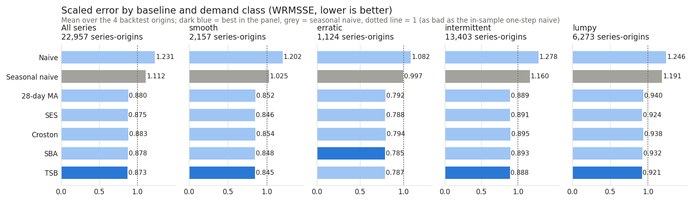
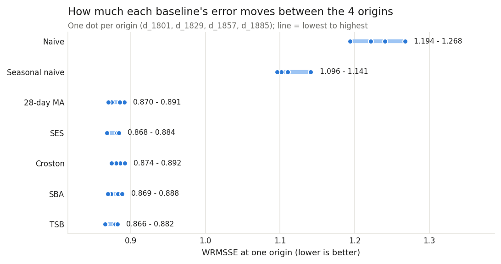
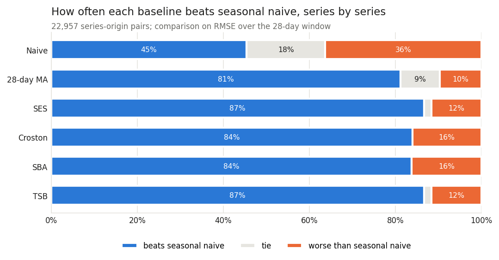

# F3: Baselines and the rolling-origin backtest

*Generated by `python -m forecast.run_f3` from `results/f3_backtest.json`. Do not edit the numbers by
hand.*

## What this step does, in plain words

Before building a machine-learning model (F4), we need to know how good the simple rules already
are. F3 runs 7 simple forecasting rules ("baselines") on every series and checks them
the honest way. It pretends to stand on a past day (the **origin**), forecasts the next 28 days
using only what was known on that day, and then compares the forecast with what actually sold. It
does this from 4 origins in a row: d_1801, d_1829, d_1857, d_1885. Together the windows cover d_1802
to d_1913. The final holdout starts at d_1914. F3 never reads it, and every
window ends before it.

**Headline:** the best baseline overall is **TSB**, with a revenue-weighted scaled error
(WRMSSE) of **0.873**. "Same weekday last week" (seasonal naive) scores 1.112. The 5 smoothing rules (28-day MA, SES, Croston, SBA, TSB) lie within 0.010 of each other (0.873 to 0.883), so the order among them is not a strong result; the gap to the naive rules is.

## The baselines

| Baseline | Rule | Setting |
|---|---|---|
| Naive | tomorrow = the last listed day | none |
| Seasonal naive | each day = the same weekday last week | 7-day cycle |
| Moving average | the average of the last 28 listed days | 28 days |
| Simple exponential smoothing (SES) | a running average that weights recent days more | alpha 0.1 |
| Croston | average size of a sale ÷ average days between sales | alpha 0.1 |
| SBA | Croston × (1 − alpha/2), which removes Croston's known over-forecast | alpha 0.1 |
| TSB | chance of a sale on a day × average size of a sale; the chance is updated every day | alpha 0.1 / 0.1 |

All settings are fixed in `config/backtest.yaml` with their reasons. None was tuned; tuning is for
F4, and only on these backtest windows. Unlisted days ("not on sale") are skipped by every rule and
never scored.

## How the errors are measured

For each series, origin and baseline, on the listed days of the 28-day window:
- **MAE / RMSE:** average absolute / root-mean-square error in units per day.
- **Bias:** average of forecast − actual. Positive means the rule forecasts too much.
- **RMSSE:** RMSE divided by the series' own typical day-to-day change (the error of "tomorrow =
  today" on its listed days up to the origin). 1.0 means "as bad as that naive rule was in the past".
  This makes slow and fast sellers comparable.
- **WRMSSE:** the RMSSE averaged with **revenue weights**: units sold in the 28 days up to the origin
  × the last price known at the origin, as in the M5 competition. Big-selling items count more. It is
  computed per origin and then averaged over the 4 origins.
- **Weekly WAPE:** the forecast and actual summed per week, then total absolute weekly error ÷ total
  weekly units. This is closer to how a store orders stock.

The scaling denominator, the weights and the demand class are all computed from days up to the
origin only. A test changes every value after an origin and checks that none of them move.

## Which series are scored

A series is scored at an origin if it was listed on at least 56 days up to it. Series
launched later are counted, not dropped silently:

| Origin | Scored days | Series | Scored | Too little history | No listed day in window | Zero scale | Series-days scored |
|---|---|---|---|---|---|---|---|
| d_1801 | d_1802..d_1829 | 5,748 | 5,733 | 15 | 0 | 0 | 160,524 |
| d_1829 | d_1830..d_1857 | 5,748 | 5,735 | 13 | 0 | 0 | 160,580 |
| d_1857 | d_1858..d_1885 | 5,748 | 5,743 | 5 | 0 | 0 | 160,804 |
| d_1885 | d_1886..d_1913 | 5,748 | 5,746 | 2 | 0 | 0 | 160,888 |

In total 22,957 series-origin pairs are scored. Demand classes are recomputed at every origin from
days up to it (at d_1885: smooth 535, erratic 276, intermittent 3,363, lumpy 1,572).

## 1. Overall results

| Baseline | WRMSSE | Mean RMSSE | Median RMSSE | Mean MAE | Mean bias | Weekly WAPE |
|---|---|---|---|---|---|---|
| Naive (last day) | 1.231 | 0.993 | 0.876 | 1.911 | +0.459 | 80.6% |
| Seasonal naive (same weekday last week) | 1.112 | 0.959 | 0.919 | 1.647 | -0.072 | 41.7% |
| 28-day moving average | 0.880 | 0.746 | 0.712 | 1.389 | -0.088 | 38.1% |
| Simple exponential smoothing | 0.875 | 0.745 | 0.714 | 1.385 | -0.050 | 37.8% |
| Croston | 0.883 | 0.785 | 0.723 | 1.498 | +0.064 | 42.8% |
| SBA (bias-corrected Croston) | 0.878 | 0.781 | 0.720 | 1.476 | -0.038 | 42.2% |
| TSB | 0.873 | 0.743 | 0.712 | 1.383 | -0.052 | 37.5% |



**Plain reading:**
- Every smoothing rule beats both naive rules (worst smoothing rule 0.883, best naive rule 1.112). TSB has the lowest WRMSSE (0.873,
  against 1.112 for seasonal naive). TSB has the lowest unweighted mean RMSSE
  (0.743, against 0.959).
- Naive and Seasonal naive score above 1 (WRMSSE). Copying one day, or one week, carries that day's noise straight into all of the forecast days; averaging over many days removes most of it.
- On weekly totals the lowest error is TSB (weekly WAPE 37.5%).

## 2. By demand class

WRMSSE per baseline; bold = lowest in the row.

| Class | Series-origins | Naive | Seasonal naive | 28-day moving average | Simple exponential smoothing | Croston | SBA | TSB |
|---|---|---|---|---|---|---|---|---|
| smooth | 2,157 | 1.202 | 1.025 | 0.852 | 0.846 | 0.854 | 0.848 | **0.845** |
| erratic | 1,124 | 1.082 | 0.997 | 0.792 | 0.788 | 0.794 | **0.785** | 0.787 |
| intermittent | 13,403 | 1.278 | 1.160 | 0.889 | 0.891 | 0.895 | 0.893 | **0.888** |
| lumpy | 6,273 | 1.246 | 1.191 | 0.940 | 0.924 | 0.938 | 0.932 | **0.921** |

Best per class:
- smooth: TSB (WRMSSE 0.845; lowest mean RMSSE: TSB, 0.762)
- erratic: SBA (bias-corrected Croston) (WRMSSE 0.785; lowest mean RMSSE: TSB, 0.684)
- intermittent: TSB (WRMSSE 0.888; lowest mean RMSSE: TSB, 0.766)
- lumpy: TSB (WRMSSE 0.921; lowest mean RMSSE: TSB, 0.698)

Croston-type rules (Croston, SBA, TSB) were expected to help most on intermittent and lumpy series.
In this slice the difference is small: intermittent: best Croston-type TSB 0.888 vs best plain average 28-day MA 0.889; lumpy: best Croston-type TSB 0.921 vs best plain average SES 0.924. Croston's mean bias is +0.064 units a day and SBA's -0.038, so the bias correction works as intended. TSB is not better than Croston and SBA in every class.

## 3. Stability across the origins

| Origin | Naive | Seasonal naive | 28-day moving average | Simple exponential smoothing | Croston | SBA | TSB | Best |
|---|---|---|---|---|---|---|---|---|
| d_1801 | 1.194 | 1.141 | 0.891 | 0.881 | 0.886 | 0.883 | 0.879 | TSB |
| d_1829 | 1.268 | 1.101 | 0.885 | 0.884 | 0.892 | 0.888 | 0.882 | TSB |
| d_1857 | 1.241 | 1.096 | 0.874 | 0.868 | 0.881 | 0.873 | 0.866 | TSB |
| d_1885 | 1.221 | 1.110 | 0.870 | 0.868 | 0.874 | 0.869 | 0.866 | TSB |



TSB has the lowest WRMSSE at every origin. Its WRMSSE ranges from 0.866 to 0.882 across the origins. The order of the naive
rules versus the smoothing rules is the same at every origin. The close ranking among the smoothing
rules can change with the origin, so differences in the third decimal should not be read as real.

## 4. By department

| Department | Series-origins | Naive | Seasonal naive | 28-day moving average | Simple exponential smoothing | Croston | SBA | TSB | Best |
|---|---|---|---|---|---|---|---|---|---|
| FOODS_1 | 3,456 | 1.111 | 1.134 | 0.853 | 0.852 | 0.859 | 0.852 | 0.849 | TSB |
| FOODS_2 | 6,350 | 1.241 | 1.153 | 0.886 | 0.888 | 0.888 | 0.887 | 0.885 | TSB |
| FOODS_3 | 13,151 | 1.252 | 1.092 | 0.883 | 0.875 | 0.886 | 0.880 | 0.874 | TSB |

## 5. Series by series: how often does each baseline beat seasonal naive?

Averages can hide a few very large errors, so we also count series. A "win" means a lower RMSE than
seasonal naive on the same series and window. A tie means the RMSE is the same within 1e-9, which
happens when both forecasts are essentially zero for an item that stopped selling.

| Baseline | Wins | Ties | Losses | Win share (pairs) | Series that win on average over the origins |
|---|---|---|---|---|---|
| Naive (last day) | 10,424 | 4,199 | 8,334 | 45% | 2,861 of 5,746 (50%) |
| 28-day moving average | 18,647 | 2,085 | 2,225 | 81% | 5,438 of 5,746 (95%) |
| Simple exponential smoothing | 19,891 | 394 | 2,672 | 87% | 5,541 of 5,746 (96%) |
| Croston | 19,272 | 0 | 3,685 | 84% | 4,985 of 5,746 (87%) |
| SBA (bias-corrected Croston) | 19,243 | 0 | 3,714 | 84% | 5,007 of 5,746 (87%) |
| TSB | 19,892 | 393 | 2,672 | 87% | 5,546 of 5,746 (97%) |



Win share (series-origin pairs) by demand class:

| Class | Naive | 28-day moving average | Simple exponential smoothing | Croston | SBA | TSB |
|---|---|---|---|---|---|---|
| smooth | 48% | 85% | 88% | 87% | 85% | 88% |
| erratic | 51% | 84% | 88% | 86% | 86% | 88% |
| intermittent | 44% | 81% | 87% | 84% | 84% | 87% |
| lumpy | 46% | 79% | 85% | 82% | 82% | 85% |

## 6. Weekly totals for the whole slice

For inventory the slice total per week matters too. Summed over all scored series, the forecast
total minus the actual total, as a % of the actual, over the 16 origin-weeks: TSB -13.9% to +8.0% (mean absolute 5.2%); Seasonal naive -11.7% to +6.7% (mean absolute 6.2%).
A flat forecast cannot follow the week-to-week swings of the total (holidays, the start of the month),
which is one reason calendar features are planned for F4. Per-week numbers are in
`results/f3_weekly_totals.csv`.

## What F3 hands to F4

- The bar to beat: TSB at WRMSSE 0.873 on these same 4 windows, and the win
  counts against seasonal naive.
- The harness (`src/forecast/backtest.py`): the same origins, metrics, weights and eligibility rule
  will score the LightGBM model, so the comparison is like for like.
- `data/processed/f3_series_metrics.parquet` (gitignored): metrics per series, origin and baseline.
- `results/f3_backtest.json`, `results/f3_summary.csv`, `results/f3_weekly_totals.csv`: aggregates only.

## How to reproduce

```bash
.venv/bin/python -m forecast.run_f1   # builds data/processed/m5_slice.parquet
.venv/bin/python -m forecast.run_f3   # this step
.venv/bin/python -m pytest && .venv/bin/python -m pytest -m realdata
```
