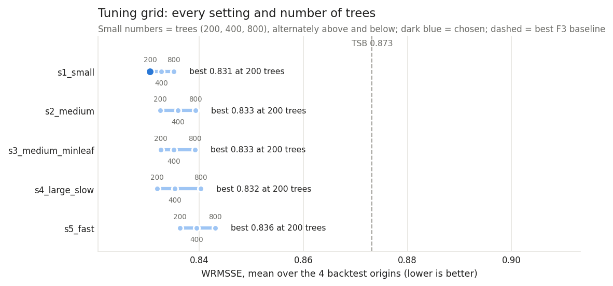
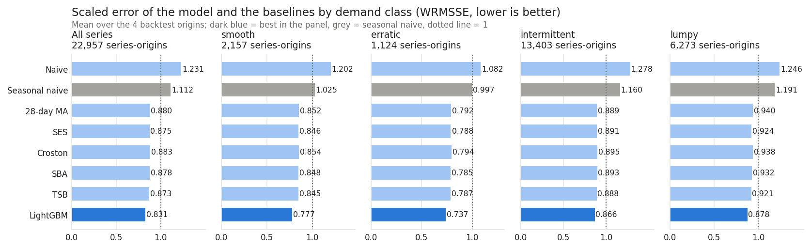
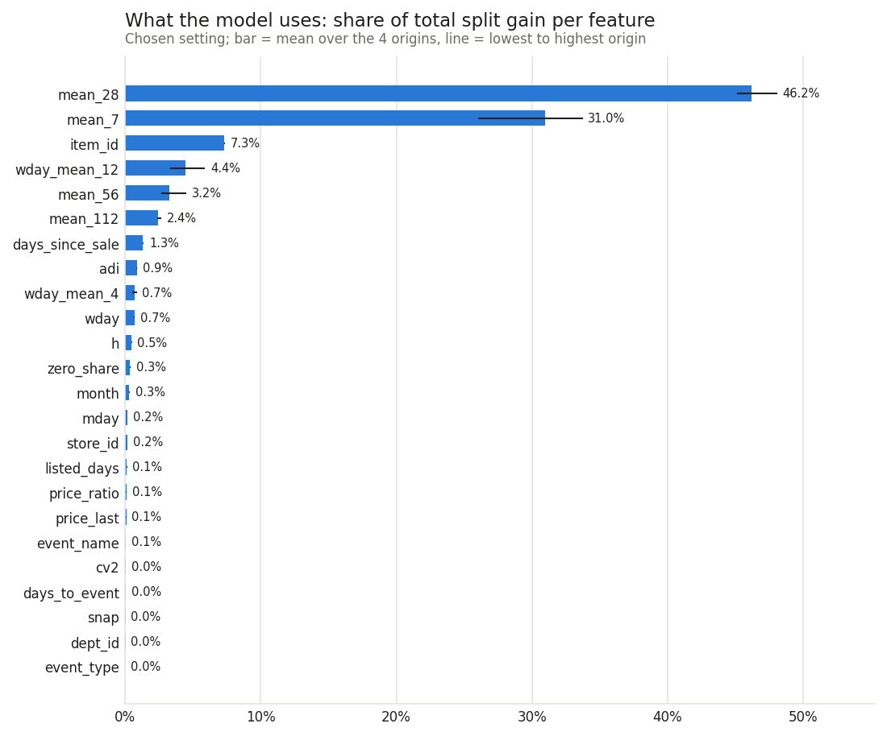

# F4 (part A): A global LightGBM model on the backtest, then freeze

*Generated by `python -m forecast.run_f4` from `results/f4_backtest.json`. Do not edit the numbers by
hand.*

## What this step does, in plain words

F3 showed how well simple rules forecast. F4 trains one machine-learning model (LightGBM, gradient-
boosted trees) for all series at once. It learns from the past: "an item that sold this much
recently, on this weekday, at this price, before this holiday, sold this much on day h". It is
checked on exactly the same 4 backtest windows (d_1801, d_1829, d_1857, d_1885), series and days as the F3
baselines, with the same error measures. The final holdout (from d_1914) is not read,
scored or tuned on here. The chosen setup is frozen for one run on the holdout later (part B).

**Headline:** The global LightGBM model has a WRMSSE of **0.831**, against **0.873** for the best F3 baseline (TSB) and 1.112 for seasonal naive: 4.9% lower than the best baseline.

## How the model is set up

- **One model, many series, direct horizons.** One row = (series, forecast origin, target day). The
  horizon h = 1..28 is a feature, so one model forecasts all 28 days at once and never
  feeds its own forecasts back in.
- **Training rows.** For a backtest origin B, rows come from 26 earlier origins, one every
  14 days, the newest at B − 28. So every training target day is on or before B, and
  one year of history (every season and holiday once) is covered. That is 3,996,443 to 4,067,455 rows per
  backtest origin.
- **Features as of the origin (24 in total).** Recent means over 7/28/56/112 days, the
  same-weekday mean over 4 and 12 weeks, share of zero days, days since the last sale, listed days so
  far, ADI and CV², the last known price (F3's last-full-week rule, never a future price) and its
  ratio to the item's own one-year mean price, and item / department / store as categories.
  Calendar facts of the target day are known in advance: weekday, month, day of month, SNAP, event
  name and type, and the distance to the nearest event.
- **What it never sees.** No unit, price or listing after the origin. No price of the target day.
  Not even the price of the origin's own unfinished week. Tests change every value after an origin
  and check that no feature moves. A guard refuses any day from d_1914 on unless the
  one-shot holdout run asks for it explicitly.
- **Unlisted days** (not on sale) are never training targets and never scored. **Christmas** (stores
  closed) is dropped from the training targets, forecast as 0, and ignored in the history features.
- **Loss: Tweedie** (power 1.1). Daily sales are counts with many zeros and a long tail.
  Tweedie handles both and predicts the mean.

## 1. Tuning grid (backtest only)

Each setting was trained once per origin. It was scored after 200 / 400 / 800 trees, because the
first n trees of a run are the n-tree model. The winner has the lowest WRMSSE averaged over the
4 origins. Here is the whole grid, not only the winner:

| Setting | Leaves | Learning rate | Min rows per leaf | Trees | d_1801 | d_1829 | d_1857 | d_1885 | Mean |
|---|---|---|---|---|---|---|---|---|---|
| s1_small | 31 | 0.05 | 100 | 200 | 0.823 | 0.853 | 0.837 | 0.809 | **0.831** |
| s1_small | 31 | 0.05 | 100 | 400 | 0.828 | 0.855 | 0.837 | 0.811 | 0.833 |
| s1_small | 31 | 0.05 | 100 | 800 | 0.831 | 0.861 | 0.839 | 0.810 | 0.835 |
| s2_medium | 127 | 0.05 | 100 | 200 | 0.826 | 0.859 | 0.838 | 0.807 | 0.833 |
| s2_medium | 127 | 0.05 | 100 | 400 | 0.830 | 0.865 | 0.840 | 0.808 | 0.836 |
| s2_medium | 127 | 0.05 | 100 | 800 | 0.837 | 0.870 | 0.842 | 0.809 | 0.839 |
| s3_medium_minleaf | 127 | 0.05 | 1000 | 200 | 0.826 | 0.858 | 0.837 | 0.809 | 0.833 |
| s3_medium_minleaf | 127 | 0.05 | 1000 | 400 | 0.830 | 0.862 | 0.839 | 0.809 | 0.835 |
| s3_medium_minleaf | 127 | 0.05 | 1000 | 800 | 0.837 | 0.866 | 0.842 | 0.812 | 0.839 |
| s4_large_slow | 255 | 0.03 | 500 | 200 | 0.823 | 0.859 | 0.838 | 0.808 | 0.832 |
| s4_large_slow | 255 | 0.03 | 500 | 400 | 0.830 | 0.864 | 0.838 | 0.809 | 0.835 |
| s4_large_slow | 255 | 0.03 | 500 | 800 | 0.838 | 0.869 | 0.842 | 0.812 | 0.840 |
| s5_fast | 63 | 0.1 | 200 | 200 | 0.829 | 0.864 | 0.842 | 0.810 | 0.836 |
| s5_fast | 63 | 0.1 | 200 | 400 | 0.834 | 0.871 | 0.843 | 0.810 | 0.840 |
| s5_fast | 63 | 0.1 | 200 | 800 | 0.840 | 0.876 | 0.845 | 0.811 | 0.843 |

**Chosen: s1_small** (31 leaves, learning rate 0.05, at least 100 rows
per leaf, 200 trees), mean WRMSSE 0.831. The 15 grid points range from 0.831 to 0.843 WRMSSE, so the choice of setting moves the result by 0.012. The winner scores 0.809 to 0.853 across the origins. The best setting per origin: d_1801 s1_small, d_1829 s1_small, d_1857 s3_medium_minleaf, d_1885 s2_medium. The winner sits at the edge of the grid (the fewest trees tried and the smallest trees tried), so a smaller model might score a little better; that was not tried (see NOTES).

## 2. Overall: model vs baselines

Same 22,957 series-origin pairs for every method. The F3 baselines, recomputed in this run,
match the saved F3 results exactly.

| Method | WRMSSE | Mean RMSSE | Median RMSSE | Mean MAE | Mean bias (units/day) | Slice total bias | Weekly WAPE |
|---|---|---|---|---|---|---|---|
| Naive (last day) | 1.231 | 0.993 | 0.876 | 1.911 | +0.459 | +23.1% | 80.6% |
| Seasonal naive (same weekday last week) | 1.112 | 0.959 | 0.919 | 1.647 | -0.072 | -3.7% | 41.7% |
| 28-day moving average | 0.880 | 0.746 | 0.712 | 1.389 | -0.088 | -4.4% | 38.1% |
| Simple exponential smoothing | 0.875 | 0.745 | 0.714 | 1.385 | -0.050 | -2.5% | 37.8% |
| Croston | 0.883 | 0.785 | 0.723 | 1.498 | +0.064 | +3.2% | 42.8% |
| SBA (bias-corrected Croston) | 0.878 | 0.781 | 0.720 | 1.476 | -0.038 | -1.9% | 42.2% |
| TSB | 0.873 | 0.743 | 0.712 | 1.383 | -0.052 | -2.6% | 37.5% |
| **LightGBM (global)** | 0.831 | 0.730 | 0.687 | 1.341 | -0.085 | -4.3% | 36.6% |

## 3. By demand class

Demand classes are recomputed at each origin from days up to it (as in F3).

| Class | Series-origins | LightGBM (global) | TSB | Seasonal naive | Model vs TSB | Model bias | TSB bias |
|---|---|---|---|---|---|---|---|
| smooth | 2,157 | 0.777 | 0.845 | 1.025 | -8.1% | -0.282 | -0.058 |
| erratic | 1,124 | 0.737 | 0.787 | 0.997 | -6.4% | +0.238 | +0.216 |
| intermittent | 13,403 | 0.866 | 0.888 | 1.160 | -2.5% | -0.074 | -0.067 |
| lumpy | 6,273 | 0.878 | 0.921 | 1.191 | -4.7% | -0.097 | -0.066 |

The model is better than TSB in every class.

## 4. Stability across origins

| Origin | LightGBM (global) | TSB | Seasonal naive | Model vs TSB | Best F3 baseline at this origin |
|---|---|---|---|---|---|
| d_1801 | 0.823 | 0.879 | 1.141 | -6.4% | TSB |
| d_1829 | 0.853 | 0.882 | 1.101 | -3.3% | TSB |
| d_1857 | 0.837 | 0.866 | 1.096 | -3.3% | TSB |
| d_1885 | 0.809 | 0.866 | 1.110 | -6.5% | TSB |

The model beats TSB at 4 of 4 origins (gap -6.5% to -3.3%).

## 5. By department

| Department | Series-origins | LightGBM (global) | TSB | Seasonal naive | Model vs TSB |
|---|---|---|---|---|---|
| FOODS_1 | 3,456 | 0.825 | 0.849 | 1.134 | -2.9% |
| FOODS_2 | 6,350 | 0.854 | 0.885 | 1.153 | -3.4% |
| FOODS_3 | 13,151 | 0.822 | 0.874 | 1.092 | -5.9% |

## 6. Series by series: wins

A win means a lower RMSE on the same series and window. Ties (within 1e-9) are mostly items with no
recent sales, where both forecasts are about zero.

| Comparison | Wins | Ties | Losses | Win share (pairs) | Series that win on average over the origins |
|---|---|---|---|---|---|
| vs Seasonal naive (same weekday last week) | 20,140 | 0 | 2,817 | 88% | 5,420 of 5,746 (94%) |
| vs TSB (best F3 baseline) | 14,513 | 0 | 8,444 | 63% | 4,028 of 5,746 (70%) |

Win share (series-origin pairs) by class:

| Class | vs seasonal naive | vs TSB |
|---|---|---|
| smooth | 93% | 72% |
| erratic | 90% | 66% |
| intermittent | 87% | 62% |
| lumpy | 86% | 62% |

## 7. Bias and weekly totals

The model's mean bias is -0.085 units per series-day, and the slice total over all windows is
-4.3% against the actual (TSB: -2.6%). Weekly slice totals over the
16 origin-weeks (forecast minus actual, as % of actual): LightGBM -12.4% to +4.7% (mean absolute 5.3%); TSB -13.9% to +8.0% (mean absolute 5.2%); Seasonal naive -11.7% to +6.7% (mean absolute 6.2%). For the first window
(origin d_1801, just after Christmas and New Year) the weekly errors are -12.4% to -7.4%
for the model and -13.9% to -8.3% for TSB. Per-week numbers are in `results/f4_backtest.json`.

## 8. What the model uses (gain importance)

Share of the total split gain, chosen setting, mean over the origins (and lowest to highest
origin). The top five: `mean_28` (46%), `mean_7` (31%), `item_id` (7%), `wday_mean_12` (4%), `mean_56` (3%). Price features together: 0.2%. Calendar features of
the target day together: 1.3%. Gain shows what the trees split on, not cause and effect.
Correlated features (the four means) share credit between them.

| Rank | Feature | Mean share | Range over origins |
|---|---|---|---|
| 1 | `mean_28` | 46.2% | 45.1% to 48.1% |
| 2 | `mean_7` | 31.0% | 26.0% to 33.7% |
| 3 | `item_id` | 7.3% | 7.3% to 7.4% |
| 4 | `wday_mean_12` | 4.4% | 3.3% to 5.9% |
| 5 | `mean_56` | 3.2% | 2.7% to 4.5% |
| 6 | `mean_112` | 2.4% | 2.3% to 2.7% |
| 7 | `days_since_sale` | 1.3% | 1.3% to 1.4% |
| 8 | `adi` | 0.9% | 0.8% to 0.9% |
| 9 | `wday_mean_4` | 0.7% | 0.5% to 0.9% |
| 10 | `wday` | 0.7% | 0.7% to 0.7% |
| 11 | `h` | 0.5% | 0.4% to 0.5% |
| 12 | `zero_share` | 0.3% | 0.3% to 0.4% |
| 13 | `month` | 0.3% | 0.3% to 0.3% |
| 14 | `mday` | 0.2% | 0.1% to 0.2% |
| 15 | `store_id` | 0.2% | 0.1% to 0.2% |
| 16 | `listed_days` | 0.1% | 0.1% to 0.1% |
| 17 | `price_ratio` | 0.1% | 0.1% to 0.1% |
| 18 | `price_last` | 0.1% | 0.1% to 0.1% |
| 19 | `event_name` | 0.1% | 0.1% to 0.1% |
| 20 | `cv2` | 0.0% | 0.0% to 0.1% |
| 21 | `days_to_event` | 0.0% | 0.0% to 0.0% |
| 22 | `snap` | 0.0% | 0.0% to 0.0% |
| 23 | `dept_id` | 0.0% | 0.0% to 0.0% |
| 24 | `event_type` | 0.0% | 0.0% to 0.0% |

## 9. Memory and run time

The training table was estimated at 0.42 GB per backtest origin before it was built (upper bound:
every series listed on every target day). It measured at most 0.41 GB (float32). Peak memory
of the whole run was 1.85 GB (as seen by Python's `resource` module). Measured by the operating system (`/usr/bin/time -l`): maximum resident memory 1.85 GB, macOS peak memory footprint 5.41 GB (it also counts memory LightGBM's threads allocated and kept between fits), 0 swaps. One fit took 65 to 171 s. The grid took 36.9 min and the
whole run 37.1 min on an 8-core, 8 GB Mac.

## 10. Frozen for the holdout (part B)

- `config/model_final.yaml` (written by this run): the chosen setting and number of trees, and the
  exact final recipe. Train on origins every 14 days with targets up to d_1913. Forecast
  from d_1913 for the holdout days. It also stores the sha256 of `config/model.yaml`, so the
  features cannot change unnoticed.
- `python -m forecast.run_f4_holdout` (not run yet) refuses to start if the git tree is not clean or
  `results/f4_holdout.json` already exists. It records the commit hash and scores the model and every
  F3 baseline on the holdout with these same metrics.
- For F5: forecasts, actuals and residuals (actual − forecast) per series, origin, horizon and method
  (5,142,368 rows) are in `data/processed/f4_backtest_forecasts.parquet` (gitignored; per-item data is not redistributed).
