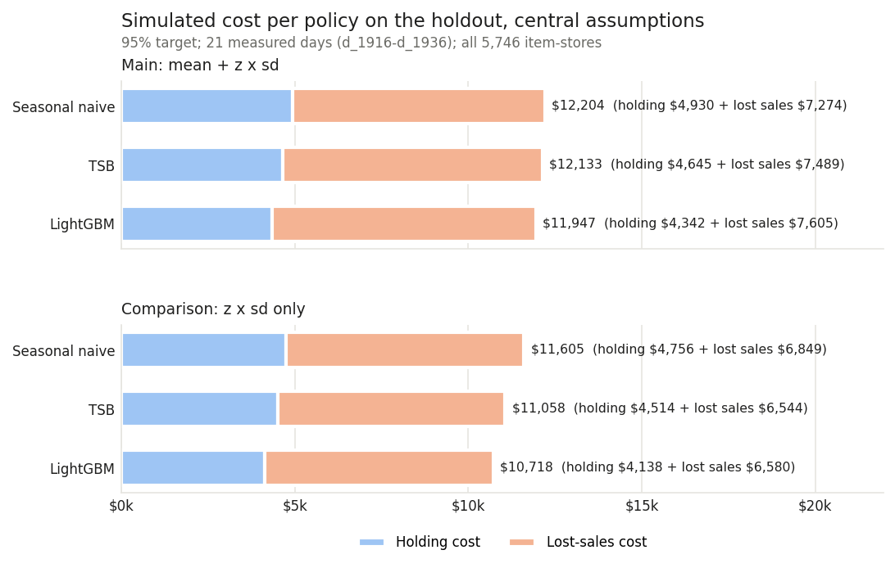
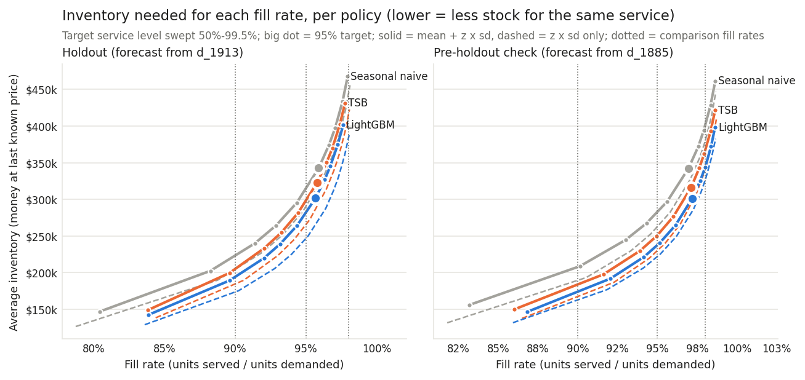
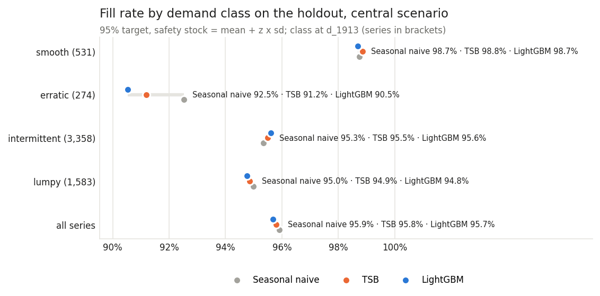
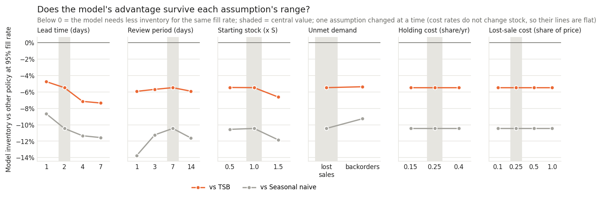

# F5: Inventory policy and simulation

*Generated by `python -m forecast.run_f5` from `results/f5_inventory.json`. Do not edit the numbers by
hand. Every money figure is a **simulated outcome under the stated assumptions** in
`config/inventory.yaml`, not an observed result.*

## What this step does, in plain words

F4 produced one fixed 28-day forecast per item-store from d_1913. This step asks what those forecasts
would be worth on the shelf. Each item-store follows the same simple ordering rule: once a week, order
enough to bring stock up to "expected demand until the next delivery after this one, plus a safety
buffer". The buffer is sized from how wrong each forecasting method was in the backtest, never from
the holdout. The rule is then replayed against what customers actually bought on the holdout days,
with three forecasts plugged in: the seasonal-naive rule (today's simple rule), TSB (the best
baseline) and the LightGBM model. The forecasts are not changed.

**Headline:** At the central scenario (95% target, lead time 2 days, a review every 7 days) the three policies reach almost the same fill rate on the holdout (Seasonal naive 95.9%, TSB 95.8%, LightGBM 95.7%), and the model-based policy holds 11.9% less average inventory than the seasonal-naive rule and 6.5% less than TSB. Read off the full curves at the same 95% fill rate, it needs $282,159 of stock against $315,076 (seasonal naive, -10.4%) and $298,495 (TSB, -5.5%).

## How the simulation works

- **Policy: periodic review, order-up-to.** On a review day the store orders
  S − (stock on hand + stock on order), rounded up to whole units. The order arrives 2 days later
  (lead time). S = forecast over the next 9 days (lead time + review period of 7 days, from
  the review day) + safety stock. Demand that finds an empty shelf is lost (grocery shoppers buy
  something else).
- **Safety stock** = mean + z × sd of the forecast error (actual − forecast) **summed over 9-day
  windows** of the backtest, per item-store and per method, with z from the target cycle service level
  (95% in the central case). Summed windows are used instead of daily sd × √days because daily errors
  are correlated (a level that is off stays off). Holdout spreads use the backtest origins
  d_1801, d_1829, d_1857, d_1885; the code refuses any origin whose errors reach the forecast days, and a test checks
  that holdout errors never change the safety stock.
- **Bias.** The main method includes the mean summed error, so an item the forecast under-forecast in
  the backtest gets more stock (and an over-forecast item less). "z × sd only" is shown as the
  comparison (section 6).
- **One forecast, end of the horizon.** The holdout has one forecast origin, so later reviews reuse
  the same forecast and are not updated with new sales (a real store would re-forecast; a limitation).
  Only reviews whose whole 9-day protection period fits inside the 28 forecast days are simulated:
  reviews on d_1914, d_1921, d_1928. Days before the first possible delivery are a warm-up; measured days are
  d_1916..d_1936 (21 days, 255,386 units of demand). Each review uses a full
  forecast sum and the same window length as its safety stock, which capping the last sum at the
  forecast end would not.
- **Start.** Day 1 starts with 1.0 × S of stock and nothing on order.
- **Money.** Units are valued at each item-store's last known price at the origin (F3 rule). Holding
  cost 25% of price per year (per unit-day = rate × price / 365) on stock at the end of each day;
  a lost unit costs 25% of its price (a gross-margin proxy). Perishability is ignored, which
  understates the cost of holding fresh food.
- **Scope.** 5,746 of 5,748 item-stores are simulated; 2 have no backtest window to size a
  safety stock and are left out.

| Assumption | Central | Sensitivity range |
|---|---|---|
| Lead time (days) | 2 | 1, 2, 4, 7 |
| Review period (days) | 7 | 1, 3, 7, 14 |
| Target cycle service level | 95% | sweep 50%, 70%, 80%, 85%, 90%, 95%, 97%, 98%, 99%, 99.5% |
| Holding cost (share of price per year) | 25% | 0.15, 0.25, 0.4 |
| Lost-sale cost (share of price) | 25% | 0.1, 0.25, 0.5, 1.0 |
| Unmet demand | lost sales | lost sales, backorders |
| Starting stock (× S) | 1.0 | 0.5, 1.0, 1.5 |
| Perishability | ignored | not varied (stated limitation) |

## 1. The central scenario on the holdout

| Policy | Fill rate | Cycle service level | Stockout days (share of item-days) | Avg inventory (units) | Avg inventory (money) | Holding cost | Lost-sales cost | Total cost |
|---|---|---|---|---|---|---|---|---|
| Seasonal naive | 95.9% | 92.2% | 2.3% | 123,231 | $342,736 | $4,930 | $7,274 | **$12,204** |
| TSB | 95.8% | 92.1% | 2.3% | 117,376 | $322,912 | $4,645 | $7,489 | **$12,133** |
| LightGBM | 95.7% | 91.8% | 2.4% | 109,173 | $301,867 | $4,342 | $7,605 | **$11,947** |

Fill rate = units served / units demanded. Cycle service level = share of (item-store, order cycle)
pairs without a lost sale; it is what the target refers to. Costs are totals over the 21
measured days for the whole slice. Ranking by total cost: LightGBM > TSB > Seasonal naive.

The achieved cycle service level is below the 95% target for every policy (Seasonal naive 92.2%, TSB 92.1%, LightGBM 91.8%; -3.2 to -2.8 points). A likely reason (TO VERIFY in NOTES): the normal z assumes bell-shaped errors, while summed errors of mostly intermittent items are skewed, so the normal quantile under-covers the right tail; the spread also comes from only a few backtest windows. The fill rate counts units, so a cycle that misses a few of many units lowers it only a little; that is why it is higher than the cycle service level.

## 2. The trade-off: how much stock for the same fill rate

The target service level was swept over 50%, 70%, 80%, 85%, 90%, 95%, 97%, 98%, 99%, 99.5%. Each point is one setting; reading the curves at the
same fill rate compares the policies fairly, because a given target does not give every policy the same
fill rate.

Inventory money needed at a given fill rate (holdout, main safety stock; "n/a" = the curve does not
reach it within the sweep):

| Fill rate | Seasonal naive | TSB | LightGBM | Model vs seasonal naive | Model vs TSB |
|---|--- | --- | ---|---|---|
| 90% | $223,364 | $205,046 | $194,231 | -13.0% | -5.3% |
| 95% | $315,076 | $298,495 | $282,159 | -10.4% | -5.5% |
| 98% | n/a | n/a | n/a | n/a | n/a |

## 3. By demand class, department and revenue

Fill rate and average inventory money per group (holdout, central scenario, main safety stock).

| Class | Item-stores | Fill rate: Seasonal naive | TSB | LightGBM | Inventory: Seasonal naive | TSB | LightGBM |
|---|---|--- | --- | ---|--- | --- | ---|
| smooth | 531 | 98.7% | 98.8% | 98.7% | $76,277 | $74,946 | $71,099 |
| erratic | 274 | 92.5% | 91.2% | 90.5% | $22,737 | $21,653 | $20,400 |
| intermittent | 3,358 | 95.3% | 95.5% | 95.6% | $162,515 | $150,431 | $140,296 |
| lumpy | 1,583 | 95.0% | 94.9% | 94.8% | $81,208 | $75,882 | $70,071 |

| Department | Item-stores | Fill rate: Seasonal naive | TSB | LightGBM | Inventory: Seasonal naive | TSB | LightGBM | Total cost: Seasonal naive | TSB | LightGBM |
|---|---|--- | --- | ---|--- | --- | ---|--- | --- | ---|
| FOODS_1 | 864 | 91.7% | 91.3% | 90.4% | $45,937 | $40,796 | $37,566 | $2,130 | $2,194 | $2,314 |
| FOODS_2 | 1,592 | 96.7% | 96.9% | 97.3% | $86,804 | $80,617 | $76,838 | $2,547 | $2,368 | $2,168 |
| FOODS_3 | 3,290 | 96.5% | 96.4% | 96.3% | $209,995 | $201,498 | $187,463 | $7,527 | $7,571 | $7,465 |

| Revenue group (weight at the origin) | Item-stores | Fill rate: Seasonal naive | TSB | LightGBM | Inventory: Seasonal naive | TSB | LightGBM | Total cost: Seasonal naive | TSB | LightGBM |
|---|---|--- | --- | ---|--- | --- | ---|--- | --- | ---|
| top 10% by revenue | 575 | 98.9% | 99.1% | 98.9% | $125,755 | $124,858 | $117,610 | $2,857 | $2,599 | $2,620 |
| other items | 5,171 | 94.2% | 93.8% | 93.8% | $216,981 | $198,053 | $184,257 | $9,347 | $9,534 | $9,327 |

## 4. Sensitivity: does the ranking survive the assumptions?

Each assumption is moved over its range with the others at their central values (20 scenarios).
Reviews / measured days change with lead time and review period because of the end-of-horizon rule.
Fill rate and total cost are at the 95% target, listed as Seasonal naive | TSB | LightGBM.

| Assumption | Value | Reviews / measured days | Fill rate | Total cost | Ranking by total cost | Model inventory vs seasonal naive at 95% fill | vs TSB |
|---|---|---|---|---|---|---|---|
| lead_time_days | 1 | 3 / 21 | 96.1% / 95.9% / 95.8% | $11,619 / $11,694 / $11,493 | LightGBM > Seasonal naive > TSB | -8.7% | -4.7% |
| lead_time_days | 2 (central) | 3 / 21 | 95.9% / 95.8% / 95.7% | $12,204 / $12,133 / $11,947 | LightGBM > TSB > Seasonal naive | -10.4% | -5.5% |
| lead_time_days | 4 | 3 / 21 | 95.5% / 95.5% / 95.3% | $13,517 / $13,337 / $13,202 | LightGBM > TSB > Seasonal naive | -11.3% | -7.1% |
| lead_time_days | 7 | 3 / 21 | 94.0% / 93.8% / 93.9% | $17,046 / $17,025 / $16,434 | LightGBM > TSB > Seasonal naive | -11.6% | -7.3% |
| review_period_days | 1 | 26 / 26 | 95.3% / 94.0% / 94.1% | $12,825 / $15,185 / $14,867 | Seasonal naive > LightGBM > TSB | -13.8% | -5.9% |
| review_period_days | 3 | 8 / 24 | 95.8% / 95.4% / 95.3% | $11,703 / $12,195 / $12,102 | Seasonal naive > LightGBM > TSB | -11.2% | -5.7% |
| review_period_days | 7 (central) | 3 / 21 | 95.9% / 95.8% / 95.7% | $12,204 / $12,133 / $11,947 | LightGBM > TSB > Seasonal naive | -10.4% | -5.5% |
| review_period_days | 14 | 1 / 14 | 95.7% / 95.6% / 95.5% | $10,676 / $10,423 / $10,115 | LightGBM > TSB > Seasonal naive | -11.6% | -5.9% |
| starting_inventory_factor | 0.5 | 3 / 21 | 95.9% / 95.8% / 95.7% | $12,139 / $12,053 / $11,867 | LightGBM > TSB > Seasonal naive | -10.6% | -5.5% |
| starting_inventory_factor | 1.0 (central) | 3 / 21 | 95.9% / 95.8% / 95.7% | $12,204 / $12,133 / $11,947 | LightGBM > TSB > Seasonal naive | -10.4% | -5.5% |
| starting_inventory_factor | 1.5 | 3 / 21 | 96.6% / 96.5% / 96.4% | $12,668 / $12,433 / $12,038 | LightGBM > TSB > Seasonal naive | -11.8% | -6.6% |
| unmet_demand | lost sales (central) | 3 / 21 | 95.9% / 95.8% / 95.7% | $12,204 / $12,133 / $11,947 | LightGBM > TSB > Seasonal naive | -10.4% | -5.5% |
| unmet_demand | backorders | 3 / 21 | 95.0% / 94.8% / 94.7% | $13,589 / $13,632 / $13,468 | LightGBM > Seasonal naive > TSB | -9.3% | -5.4% |
| holding_cost_rate_per_year | 0.15 | 3 / 21 | 95.9% / 95.8% / 95.7% | $10,232 / $10,275 / $10,210 | LightGBM > Seasonal naive > TSB | -10.4% | -5.5% |
| holding_cost_rate_per_year | 0.25 (central) | 3 / 21 | 95.9% / 95.8% / 95.7% | $12,204 / $12,133 / $11,947 | LightGBM > TSB > Seasonal naive | -10.4% | -5.5% |
| holding_cost_rate_per_year | 0.4 | 3 / 21 | 95.9% / 95.8% / 95.7% | $15,161 / $14,920 / $14,552 | LightGBM > TSB > Seasonal naive | -10.4% | -5.5% |
| stockout_cost_share_of_price | 0.1 | 3 / 21 | 95.9% / 95.8% / 95.7% | $7,839 / $7,640 / $7,384 | LightGBM > TSB > Seasonal naive | -10.4% | -5.5% |
| stockout_cost_share_of_price | 0.25 (central) | 3 / 21 | 95.9% / 95.8% / 95.7% | $12,204 / $12,133 / $11,947 | LightGBM > TSB > Seasonal naive | -10.4% | -5.5% |
| stockout_cost_share_of_price | 0.5 | 3 / 21 | 95.9% / 95.8% / 95.7% | $19,477 / $19,622 / $19,552 | Seasonal naive > LightGBM > TSB | -10.4% | -5.5% |
| stockout_cost_share_of_price | 1.0 | 3 / 21 | 95.9% / 95.8% / 95.7% | $34,025 / $34,599 / $34,762 | Seasonal naive > TSB > LightGBM | -10.4% | -5.5% |

The model-based policy has the lowest simulated total cost in 16 of 20 scenarios. It is not first in: review_period_days = 1 (Seasonal naive first); review_period_days = 3 (Seasonal naive first); stockout_cost_share_of_price = 0.5 (Seasonal naive first); stockout_cost_share_of_price = 1.0 (Seasonal naive first). In each of these the cheaper policy reaches a higher fill rate than the model at the same nominal target (Seasonal naive 95.3% vs LightGBM 94.1%; Seasonal naive 95.8% vs LightGBM 95.3%; Seasonal naive 95.9% vs LightGBM 95.7%; Seasonal naive 95.9% vs LightGBM 95.7%), because its wider backtest errors give it a bigger safety stock, and the lost sales it avoids are worth more than the extra stock costs. A fixed target therefore does not compare like with like; the comparison at equal fill rate below does.

At an equal 95% fill rate the model needs less inventory than both baselines in every one of the 20 scenarios: -7.3% to -4.7% against TSB and -13.8% to -8.7% against seasonal naive.

## 5. Where the money is

Shares of the total under each policy (holdout, central scenario). "Top 10%" = the 10% of
item-stores with the most of that quantity under that policy.

| Policy | Lost-sales cost | Top 10% share of it | Item-stores with any lost sale | Avg inventory money | Top 10% share of it | Top 10% share of demand units |
|---|---|---|---|---|---|---|
| Seasonal naive | $7,274 | 95% | 916 | $342,736 | 40% | 46% |
| TSB | $7,489 | 94% | 948 | $322,912 | 41% | 46% |
| LightGBM | $7,605 | 93% | 1,023 | $301,867 | 41% | 46% |

| Class | Share of demand units | Lost-sales cost: Seasonal naive | TSB | LightGBM | Inventory money: Seasonal naive | TSB | LightGBM |
|---|---|--- | --- | ---|--- | --- | ---|
| smooth | 29% | 7% | 7% | 7% | 22% | 23% | 24% |
| erratic | 12% | 15% | 19% | 20% | 7% | 7% | 7% |
| intermittent | 34% | 55% | 51% | 49% | 47% | 47% | 46% |
| lumpy | 25% | 23% | 23% | 24% | 24% | 23% | 23% |

| Revenue group | Share of demand units | Lost-sales cost: Seasonal naive | TSB | LightGBM | Inventory money: Seasonal naive | TSB | LightGBM |
|---|---|--- | --- | ---|--- | --- | ---|
| top 10% by revenue | 37% | 14% | 11% | 12% | 37% | 39% | 39% |
| other items | 63% | 86% | 89% | 88% | 63% | 61% | 61% |

Lost sales are very concentrated: under the model-based policy the top 10% of item-stores carry 93% of the lost-sales cost (only 1,023 of 5,746 item-stores lose any sale), while inventory money is spread much like demand (top 10%: 41% of inventory, 46% of demand). By class, intermittent items have the largest lost-sales share relative to their demand (49% of lost-sales cost vs 34% of demand). The top revenue items lose comparatively little (12% of lost-sales cost for 37% of demand units).

## 6. Bias handling: mean + z × sd vs z × sd only

Backtest error over the first 9-day window, per method (summed over the slice; positive = the
method under-forecast), and the central safety stock:

| Method | Mean summed error (units, slice total) | Item-stores under-forecast on average | Median sd of summed error (units) | Safety stock (units) | Safety stock (money) |
|---|---|---|---|---|---|
| Seasonal naive | +3,787 | 59% | 5.46 | 86,527 | $237,929 |
| TSB | +2,611 | 58% | 4.59 | 75,588 | $205,444 |
| LightGBM | +4,251 | 56% | 4.24 | 70,811 | $194,660 |

Main / comparison, at the 95% target and at 95% fill rate:

| Policy | Fill rate (main / z×sd) | Cycle service level (main / z×sd) | Inventory at 95% fill, holdout (main / z×sd) | Inventory at 95% fill, pre-holdout check (main / z×sd) |
|---|---|---|---|---|
| Seasonal naive | 95.9% / 96.2% | 92.2% / 92.4% | $315,076 / $290,423 | $282,930 / $262,854 |
| TSB | 95.8% / 96.4% | 92.1% / 92.8% | $298,495 / $265,627 | $250,986 / $230,086 |
| LightGBM | 95.7% / 96.4% | 91.8% / 92.6% | $282,159 / $246,684 | $237,636 / $221,985 |

In both windows the simpler z x sd version reaches the 95% fill rate with less stock than the main bias-adjusted version, for every policy. A likely reason: the per-series mean error from a few short backtest windows is mostly noise, so a series that happened to be under-forecast in the backtest gets extra stock it does not need later, and one that was over-forecast gets cut (TO VERIFY). The main method was fixed before the simulation and stays the headline; the comparison is reported, not swapped in (see NOTES: a pooled or shrunk bias term could be tested on the backtest windows).

With z × sd only, inventory money at each fill rate (holdout):

| Fill rate | Seasonal naive | TSB | LightGBM | Model vs seasonal naive | Model vs TSB |
|---|--- | --- | ---|---|---|
| 90% | $204,613 | $184,629 | $173,640 | -15.1% | -6.0% |
| 95% | $290,423 | $265,627 | $246,684 | -15.1% | -7.1% |
| 98% | $443,208 | $414,916 | $382,960 | -13.6% | -7.7% |

## 7. Robustness check before the holdout

The same simulation on the last backtest window: forecasts from d_1885 for
d_1886..d_1913 (all training days), safety stock from the earlier origins d_1801, d_1829, d_1857
only. 5,743 item-stores (3 without earlier windows left out).

| Policy | Fill rate (holdout / check) | Avg inventory money (holdout / check) | Total cost (holdout / check) | Inventory at 95% fill (holdout / check) |
|---|---|---|---|---|
| Seasonal naive | 95.9% / 97.0% | $342,736 / $342,169 | $12,204 / $10,239 | $315,076 / $282,930 |
| TSB | 95.8% / 97.1% | $322,912 / $316,407 | $12,133 / $9,678 | $298,495 / $250,986 |
| LightGBM | 95.7% / 97.2% | $301,867 / $301,300 | $11,947 / $9,250 | $282,159 / $237,636 |

Inventory money at each fill rate on the check window (main safety stock):

| Fill rate | Seasonal naive | TSB | LightGBM | Model vs seasonal naive | Model vs TSB |
|---|--- | --- | ---|---|---|
| 90% | $207,776 | $183,920 | $174,085 | -16.2% | -5.3% |
| 95% | $282,930 | $250,986 | $237,636 | -16.0% | -5.3% |
| 98% | $400,760 | $366,546 | $343,531 | -14.3% | -6.3% |

On the pre-holdout window the ranking by total cost is LightGBM > TSB > Seasonal naive, the same as on the holdout. At 95% fill rate the model needs 16.0% less inventory than seasonal naive and 5.3% less than TSB (holdout: 10.4% less and 5.5% less). So the conclusion does not rest on the one holdout window.

## 8. Limits

- **Simulated, not observed.** Costs, lead times and margins are assumptions (ranges above); the
  money figures show how the policies compare under them, not what Walmart would save.
- **One forecast per window.** Forecasts are made once and not updated at later reviews, and only
  21 days are measured; a rolling re-forecast might help every policy.
- **Normal safety factor.** z assumes bell-shaped errors; the achieved cycle service level shows how
  far that is off for these mostly intermittent items.
- **No shelf life, case packs or shelf capacity.** Fresh items would expire, orders come in packs, and
  shelves are finite; all three would change the cost of holding stock.
- **Lost demand is unobserved.** M5 records sales, not demand. On days the real shelf was empty, true
  demand was higher than the sales used here.
