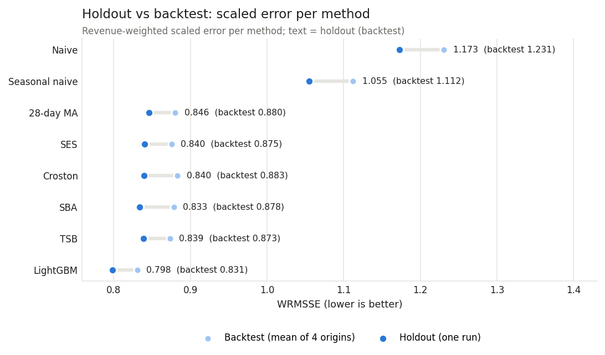

# Demand forecasting and inventory planning: findings report

**Walmart M5 data, CA FOODS: 5,748 item-store series, 2011-01-29 to 2016-05-22**
Author: Aradhya Chandra

*Generated by `python -m forecast.run_f6` from the saved files in `results/`. Do not edit by hand;
edit `docs/templates/REPORT.md` and rerun. Every number below comes from a saved result. Inventory and
money figures are **simulated outcomes under stated assumptions** (`config/inventory.yaml`), not
observed results. Price and event effects are **associations**, not proven effects.*

---

## 1. Executive summary

A store has to decide every week how much of each product to stock. This project asks whether a
machine-learning forecast makes that decision better than the simple rules a store might use today,
and by how much. The answers to the five business questions:

- **How predictable is demand?** Mostly hard to predict item by item. 91% of the
  5,748 item-stores are not "smooth": 86% are intermittent or lumpy, and a
  typical item sells on about one day in 2.1. The 9% of items that sell
  steadily account for 34% of all units.
- **How much better than simple rules is the model?** Clearly better, by a modest and stable margin.
  On 28 days it never saw (2016-04-25 to 2016-05-22), the global LightGBM model
  scored a WRMSSE of 0.798, against 0.839 for the best simple rule (TSB, chosen before the
  test) and 1.055 for "same weekday last week": 4.8% less error than TSB, about the same gap
  as in the backtest (4.9% less). It beats "same weekday last week" on 93% of items. It
  does under-forecast total demand, running 3.3% to 7.0% low a week.
- **Do prices and events move demand?** The calendar is associated with large, regular swings:
  Sundays sell +23% and Saturdays +19% against the average day, the 1st to 10th of the
  month (SNAP benefit days) +10.5%, and Labor Day +17%, while Thanksgiving
  (-25%) and New Year (-26%) sell less. A clean price effect cannot be
  measured in this data, because a new price only appears in weeks with sales; price features carry
  0.15% of the model's split gain.
- **How much safety stock, and what does it cost against today's rule?** Sizing safety stock from
  each method's own backtest errors, the model-based policy needs **5.5% less inventory than TSB
  and 10.4% less than the seasonal-naive rule for the same 95% fill rate** in the holdout
  simulation ($282,159 vs $298,495 and $315,076). The direction holds on a pre-holdout window and in all 20 assumption scenarios. Ranked by total cost at a fixed target instead, the order
  changes in 4 of 20 scenarios, so the money answer depends on the assumptions.
- **Where is the money?** Lost sales are concentrated: only 1,023 of 5,746 item-stores
  lose any sale, and the top 10% carry 93% of the lost-sales cost. Intermittent
  items carry 49% of it for 34% of demand. Inventory money is spread much like
  demand (top 10%: 41% of inventory, 46% of demand).

**Recommendation in one line:** pilot the model-based forecast for replenishment in a few stores,
with a measured fill rate and inventory as the success criteria, after fixing two known weaknesses
(the forecast runs low, and the safety factor under-delivers its service target). Section 7 lists
the steps.

## 2. Data and scope

- **Source.** The M5 forecasting competition data (Walmart; University of Nicosia / MOFC, on
  Kaggle): daily unit sales of 30,490 item-store series over 1,941 days, weekly
  prices, and a calendar with events and SNAP days. Use is limited to non-commercial and academic
  purposes, and the data may not be redistributed, so it is not in the repository.
- **Slice.** One state and one category, CA FOODS: 1,437 items in
  4 stores, 5,748 series, 11,156,868 series-days and 19,535,863 units.
  It fits an 8 GB laptop with DuckDB and parquet; the SQL that reshapes and joins the raw files is in
  `sql/`.
- **Days before an item's first week with a sale are left out.** 23.1% of
  series-days have no price. The M5 guide says a missing price means the product was not sold that
  week[^guide], and in this slice an item's first priced week is in effect its first week with a sale:
  of the 3,456 series whose prices start after the first week of the data, 3,440
  sell in that first priced week, and no price is missing after it (0 days). So the
  excluded days are the days before an item's first week with a sale. The data cannot tell whether
  the item was not yet on sale or on the shelf but unsold on those days; they are left out of training
  and scoring rather than counted as zero demand. The same fact makes the model's "listed" flag in an
  item's first week slightly informative about a sale that week (`NOTES.md`, launch-week listing
  flag). Even on priced days, 48.2% have no sale.
- **The holdout.** The last 28 days, d_1914 to d_1941
  (2016-04-25 to 2016-05-22), were set aside at the start. Every method was built
  and tuned on earlier data, then frozen in commit `1a31ed9` and scored on the holdout once
  (1.1 minutes). Nothing was changed after that run.

## 3. Demand patterns

| Demand class | Item-stores | Share of item-stores | Share of units sold |
|---|---:|---|---|
| smooth | 531 | 9.2% | 33.6% |
| erratic | 274 | 4.8% | 16.6% |
| intermittent | 3,360 | 58.5% | 26.5% |
| lumpy | 1,583 | 27.5% | 23.3% |

Items are classified by how often they sell (average days between sales, ADI) and how much the amount
varies when they do (CV²), the standard Syntetos-Boylan-Croston scheme. Most of the product list is
intermittent: plain averages would be dominated by a few fast sellers, so all errors below are
scaled per item and weighted by revenue (WRMSSE, as in the M5 competition).

The weekly cycle is the strongest regular pattern: Sunday +23%, Saturday +19% and Wednesday
-13% against the average day. The month-of-year pattern is much weaker.

## 4. Forecast accuracy

**Set-up.** Every method forecasts each item-store 28 days ahead from a fixed day, using only data up
to that day. The **backtest** does this from 4 earlier days (d_1801 to d_1885) to choose and tune
the model; the **holdout** does it once from d_1913. The baselines are 7 simple rules, from
"same as yesterday" and "same weekday last week" to smoothing rules for intermittent demand (Croston,
SBA, TSB). The model is one LightGBM model for all series (31 leaves,
200 trees) with recent sales, calendar, event, SNAP and last-known-price features. Tests
change every value after a forecast day and check that no feature moves.

**Headline.** The model is the most accurate of the 8 methods on the holdout. The smoothing rules sit
close together (backtest WRMSSE 0.873 to 0.883), so the robust baseline result is
"smoothing beats naive rules", not which smoothing rule is best. On the holdout SBA (bias-corrected Croston) scored
0.833, slightly better than TSB; the model has 4.2% less error than it too.

| Method | Holdout WRMSSE | Backtest WRMSSE (4 windows) | Holdout weekly WAPE | Holdout slice-total bias |
|---|---|---|---|---|
| Naive (last day) | 1.173 | 1.231 | 75.8% | +22.1% |
| Seasonal naive (same weekday last week) | 1.055 | 1.112 | 38.3% | -5.4% |
| 28-day moving average | 0.846 | 0.880 | 35.7% | -4.1% |
| Simple exponential smoothing | 0.840 | 0.875 | 35.2% | -2.3% |
| Croston | 0.840 | 0.883 | 36.9% | +0.8% |
| SBA (bias-corrected Croston) | 0.833 | 0.878 | 36.4% | -4.2% |
| TSB | 0.839 | 0.873 | 34.9% | -2.4% |
| **LightGBM (global model)** | 0.798 | 0.831 | 33.5% | -4.9% |

WRMSSE: each item's error relative to its own day-to-day variation, weighted by recent revenue; lower
is better and 1.0 means "as bad as copying yesterday was in the past". Every method scored better on the holdout than in the backtest, so the level moves with the period; the comparison is the order and
the gaps on the same days.

**By demand class** (holdout WRMSSE). The model beats TSB in every class, by the most on smooth items:

| Demand class | Item-stores | LightGBM | TSB | Seasonal naive | Model vs TSB, holdout | Model vs TSB, backtest |
|---|---:|---|---|---|---|---|
| smooth | 531 | 0.715 | 0.777 | 0.915 | -7.9% | -8.1% |
| erratic | 274 | 0.759 | 0.787 | 0.940 | -3.7% | -6.4% |
| intermittent | 3,360 | 0.852 | 0.887 | 1.148 | -3.9% | -2.5% |
| lumpy | 1,583 | 0.817 | 0.845 | 1.099 | -3.4% | -4.7% |

- **Item by item:** the model has a lower error than "same weekday last week" on 5,354 of
  5,748 item-stores (93%) and than TSB on 3,819 (66%).
- **Weekly totals:** weekly WAPE 33.5% for the model, 34.9% for TSB.
- **Bias:** the model under-forecasts the slice total by 4.9% over the holdout (TSB
  -2.4%), below the actual in 4 of 4 weeks (-7.0% to
  -3.3%), and by 4.3% in the backtest. It is more accurate per item but runs low in
  total, which the inventory layer has to absorb.

## 5. Drivers: price, events and SNAP (associations)

These are comparisons of sales on different kinds of days, not controlled experiments. Stores plan
promotions, stock and displays around holidays and price changes, and none of that is in the data.

- **SNAP days.** On the 1st to 10th of the month, when California pays SNAP food benefits, sales per
  listed item were +10.5% higher than on other non-event days (FOODS_1 +1.2%, FOODS_2
  +20.8%, FOODS_3 +9.9%). The lift appears on every weekday (+8.5% to +13.2%). It cannot be separated
  from other early-month income such as wages, so it is an early-month association, not a measured
  SNAP effect. For forecasting it is still a useful flag, known in advance.

- **Events.** Each event day is compared with the same weekday 1 to 4 weeks around it
  (158 occurrences). Most events have only 5 or 6 years of data, so single numbers are
  rough; the largest ones are consistent every year:

| Event | Years | Mean difference vs nearby days | Lowest to highest year |
|---|---:|---|---|
| LaborDay | 5 | +17.0% | +9.2% to +23.6% |
| PresidentsDay | 6 | +14.1% | +8.8% to +18.9% |
| VeteransDay | 5 | +9.3% | -4.9% to +17.5% |
| MartinLutherKingDay | 5 | +8.0% | +0.4% to +19.4% |
| Mother's day | 5 | -14.0% | -23.5% to -5.8% |
| Thanksgiving | 5 | -25.3% | -30.4% to -19.2% |
| NewYear | 5 | -26.4% | -42.1% to -17.0% |
| Christmas | 5 | -99.9% | -99.9% to -99.9% |

  Christmas shows -99.9%: almost no sales, consistent with stores being closed (the model
  treats it as closed). The M5 guide does not mention closures, so this is an inference from the
  data. Monday federal holidays sell more, like an extra weekend day.
- **Price.** The before/after effect of price cuts is not a clean price effect here. The M5 guide
  describes the weekly price as an "average across seven days"[^guide], and in the data it behaves
  like a price taken from sales and carried forward: in weeks with sales it changed in
  1.9% of weeks, in weeks without any sale in 9 of 221,569.
  So a new price appears only when the item sells, which makes the "cut week" partly chosen by
  sales. The model uses only the last price known on the
  forecast day; price features carry 0.15% of its split gain, against 77% for
  the 7- and 28-day sales averages and 1.3% for calendar and event features. That says
  the model cannot see future price changes, not that price does not matter.

## 6. Inventory policy and the trade-off

**The policy.** Each item-store is reviewed every 7 days. On a review day the store orders
up to "forecast demand until the delivery after next, plus a safety stock"; an order arrives
2 days later, and a shopper who finds an empty shelf is lost. The safety stock is sized from
each method's own backtest errors, summed over the 9-day protection period, for a
95% target cycle service level; holdout errors are never used (a guard in the code and a test
check this). The rule is replayed day by day against actual holdout sales for 5,746 item-stores
(2 without a backtest window are left out), 3 reviews and 21
measured days (d_1916 to d_1936). Three forecasts are plugged in:
seasonal naive (today's simple rule), TSB (the best baseline) and the model.

### 6.1 Equal fill rate first

A fixed target does not give every policy the same fill rate, so the fair comparison reads each
policy's inventory off its full curve at the same fill rate.

| Fill rate | Seasonal naive | TSB | LightGBM | Model vs seasonal naive | Model vs TSB |
|---|---|---|---|---|---|
| 90% | $223,364 | $205,046 | $194,231 | -13.0% | -5.3% |
| 95% | $315,076 | $298,495 | $282,159 | -10.4% | -5.5% |
| 98% | n/a | n/a | n/a | n/a | n/a |

At a 95% fill rate the model-based policy needs **$282,159** of stock on average, against
$298,495 for TSB (5.5% less) and $315,076 for seasonal naive (10.4% less). The same
simulation on the last backtest window (forecasts from d_1885 for d_1886 to
d_1913, safety stock from the earlier windows only) gives 5.3% less and
16.0% less:

| Fill rate | Seasonal naive | TSB | LightGBM | Model vs seasonal naive | Model vs TSB |
|---|---|---|---|---|---|
| 90% | $207,776 | $183,920 | $174,085 | -16.2% | -5.3% |
| 95% | $282,930 | $250,986 | $237,636 | -16.0% | -5.3% |
| 98% | $400,760 | $366,546 | $343,531 | -14.3% | -6.3% |

98% is not reached by the main safety stock within the swept targets (up to 99.5%), so it is n/a.

### 6.2 Then cost, at the central scenario

Central assumptions: holding cost 25% of price a year, a lost sale costs 25%
of its price (a gross-margin proxy), totals over 21 days for the whole slice.

| Policy | Fill rate | Cycle service level | Avg inventory | Holding cost | Lost-sales cost | Total cost |
|---|---|---|---|---|---|---|
| Seasonal naive | 95.9% | 92.2% | $342,736 | $4,930 | $7,274 | $12,204 |
| TSB | 95.8% | 92.1% | $322,912 | $4,645 | $7,489 | $12,133 |
| LightGBM | 95.7% | 91.8% | $301,867 | $4,342 | $7,605 | $11,947 |

At the 95% target all three reach about the same fill rate (95.9%, 95.8%,
95.7%), and the model-based policy holds 11.9% less average inventory than seasonal
naive and 6.5% less than TSB, with the lowest simulated total cost (LightGBM > TSB > Seasonal naive).

### 6.3 Does it survive the assumptions?

Each assumption was moved over its range with the others central (20 scenarios):

| Scenario (one assumption moved) | Cheapest at the 95% target | Model inventory vs seasonal naive at 95% fill | vs TSB |
|---|---|---|---|
| lead time 1 day | LightGBM > Seasonal naive > TSB | -8.7% | -4.7% |
| central scenario | LightGBM > TSB > Seasonal naive | -10.4% | -5.5% |
| lead time 4 days | LightGBM > TSB > Seasonal naive | -11.3% | -7.1% |
| lead time 7 days | LightGBM > TSB > Seasonal naive | -11.6% | -7.3% |
| review every 1 day | Seasonal naive > LightGBM > TSB | -13.8% | -5.9% |
| review every 3 days | Seasonal naive > LightGBM > TSB | -11.2% | -5.7% |
| review every 14 days | LightGBM > TSB > Seasonal naive | -11.6% | -5.9% |
| starting stock 0.5 x S | LightGBM > TSB > Seasonal naive | -10.6% | -5.5% |
| starting stock 1.5 x S | LightGBM > TSB > Seasonal naive | -11.8% | -6.6% |
| unmet demand: backorders | LightGBM > Seasonal naive > TSB | -9.3% | -5.4% |
| holding cost 15% of price a year | LightGBM > Seasonal naive > TSB | -10.4% | -5.5% |
| holding cost 40% of price a year | LightGBM > TSB > Seasonal naive | -10.4% | -5.5% |
| lost-sale cost 10% of price | LightGBM > TSB > Seasonal naive | -10.4% | -5.5% |
| lost-sale cost 50% of price | Seasonal naive > LightGBM > TSB | -10.4% | -5.5% |
| lost-sale cost 100% of price | Seasonal naive > TSB > LightGBM | -10.4% | -5.5% |

- **Inventory at equal fill rate:** the model needs less in every one of the 20
  scenarios: 4.7% to 7.3% less than TSB and 8.7% to 13.8% less than seasonal naive.
- **Total cost at a fixed target:** the model-based policy is cheapest in 16 of
  20. It is not in 4: review every 1 day (Seasonal naive cheapest); review every 3 days (Seasonal naive cheapest); lost-sale cost 50% of price (Seasonal naive cheapest); lost-sale cost 100% of price (Seasonal naive cheapest). In those, the cheaper policy's wider
  errors give it more safety stock and a higher fill rate, and the lost sales it avoids are worth more
  than the extra stock costs. That is a property of the target, not of the forecast, which is why the
  equal-fill comparison comes first.

### 6.4 Where the money is

| Group | Share of demand units | Share of lost-sales cost | Share of inventory money |
|---|---|---|---|
| smooth | 29% | 7% | 24% |
| erratic | 12% | 20% | 7% |
| intermittent | 34% | 49% | 46% |
| lumpy | 25% | 24% | 23% |
| FOODS_1 | 13% | 23% | 12% |
| FOODS_2 | 18% | 14% | 25% |
| FOODS_3 | 69% | 63% | 62% |
| top 10% by revenue | 37% | 12% | 39% |
| other items | 63% | 88% | 61% |

- Only 1,023 of 5,746 item-stores lose any sale under the model-based policy, and the top
  10% carry 93% of the lost-sales cost ($7,605 in total over the
  measured days). This concentration is partly built in, because so few items lose anything at all;
  whether it rests on a few single large-order days was not checked.
- **Intermittent** items carry 49% of lost-sales cost for 34% of demand, and
  **erratic** ones 20% for 12%. **Smooth** items lose little (7%)
  but hold 24% of inventory money.
- By department, **FOODS_1** carries 23% of lost-sales cost for 13% of demand,
  while **FOODS_2** holds 25% of inventory for 18% of demand.
- The top 10% of items by revenue lose comparatively little (12% of
  lost-sales cost for 37% of demand).

## 7. Recommendations

1. **Pilot the model-based forecast for replenishment** in a few stores of this category, with
   matched control stores. Measure fill rate (or on-shelf availability) and average inventory; the
   simulation suggests about 5.5% less stock than the best simple rule at the same fill rate,
   which only a live test can confirm.
2. **Correct the low bias before the pilot.** The model runs 3.3% to 7.0% low per week. The per-item bias term in the safety stock did not help: plain z x sd reached the
   95% fill rate with 12.6% less stock ($246,684). A pooled bias correction (by class
   or for the slice) should be chosen on the backtest windows, not on this holdout.
3. **Size safety stock from the error distribution, not the normal curve.** The achieved cycle
   service level was 91.8% to 92.2% against a 95% target for every policy, because
   summed errors of intermittent items are skewed. Empirical quantiles of the backtest errors are the
   simple fix.
4. **Focus on where lost sales sit:** intermittent and erratic items and FOODS_1 lose more than their
   share; review their order rules and shelf space first.
5. **Replace the judgement calls with real inputs** before quoting money: lead times, margins,
   holding cost, case packs and shelf life, and record stock-outs so that lost demand becomes
   visible. Re-forecast at every review rather than once per four weeks.

## 8. Limitations

- **One holdout window.** The holdout is 28 days from a single forecast day, and the inventory
  simulation covers 3 reviews (21 measured days). The backtest's 4
  windows and the pre-holdout check give some reassurance; one spring month cannot show seasonality.
- **The forecast runs low** (-4.9% on the holdout total, -4.3% in the backtest).
- **Service below target:** achieved cycle service about 91.8% for the model at a 95%
  target (fill rate is higher, 95.7%, because it counts units).
- **Assumptions are judgement calls.** Lead time, review period, holding and lost-sale cost are not in
  the data; ranges are shown in section 6.3 and the appendix. Perishability, case packs and shelf
  capacity are ignored.
- **Associations, not effects.** Price and event figures compare different kinds of days. The SNAP
  lift cannot be separated from other early-month income. M5 prices change only in weeks with sales.
- **Sales are not demand.** On days the real shelf was empty, demand was higher than recorded.
- **Not the M5 leaderboard metric.** WRMSSE here averages item-store series only; the competition
  also averaged 11 aggregate levels.
- **Some modelling choices were not tuned:** Tweedie power 1.1, and the chosen setting is at the edge
  of a small grid (all 15 grid points scored 0.831 to 0.843 in the
  backtest, all well below TSB's 0.873).
- **One region, one category, 2011-2016.** The results are for California FOODS in these years.

## 9. How it was built

I (Aradhya Chandra) set the questions, the scope, the evaluation design and every business
assumption, and reviewed each milestone's results before the next one started. The code was written
with Claude Code, an AI coding assistant, working to rules I set: tests first, no number typed by
hand into any document, assumptions in `config/` with a reason, and the holdout scored once from a
frozen commit. Decisions and open questions are logged in `NOTES.md`, progress in `PROGRESS.md`, and
each step has its own write-up (`docs/F1` to `docs/F5`). A clean clone of the repository rebuilds the
results (`docs/F6_reproducibility.md`).

[^guide]: *The M5 Competition: Competitors' Guide*, University of Nicosia / MOFC, final version of
    10 March 2020, File 2 "sell_prices.csv". Read 2026-10-15 from the Internet Archive copy of the
    official MOFC download link (the live link now returns 404).

## Appendix: assumptions

| Assumption | Central | Range tested | Reason (config/inventory.yaml) |
|---|---|---|---|
| Lead time (days) | 2 | 1, 2, 4, 7 | Store replenishment of grocery lines from a regional distribution centre usually takes 1-3 days; 2 is the middle. 4 and 7 stand for slower direct-from-supplier lines (TO VERIFY: Walmart's actual lead times are not in the data). |
| Review period (days) | 7 | 1, 3, 7, 14 | A weekly order per item is the textbook periodic-review case and matches the weekly cycle in the data (F2). 1 and 3 stand for fast fresh lines ordered daily or twice a week, 14 for slow lines. |
| Holding cost (share of price per year) | 0.25 | 0.15, 0.25, 0.4 | Share of the item's price per year of holding one unit (capital, space, handling, shrink); 20-30% is the usual textbook range, 15-40% the sensitivity. Per unit-day = rate x price / 365, charged on stock on hand at the end of each measured day. Perishability is not included (see above). |
| Cost of a lost sale (share of price) | 0.25 | 0.1, 0.25, 0.5, 1.0 | Cost of one lost unit as a share of its price, a proxy for the lost gross margin (US grocery gross margins are roughly 25%; TO VERIFY). 10% = thin margin, 50% and 100% add lost goodwill or the rest of the basket. |
| Unmet demand | lost sales | lost sales, backorders | A grocery shopper who finds an empty shelf buys a substitute or shops elsewhere, so unmet demand is lost. Backorders (the shopper waits; the shortfall is served from the next delivery) are run only as a sensitivity check, with the same cost per short unit. |
| Starting stock (x order-up-to level) | 1.0 | 0.5, 1.0, 1.5 | Day 1 starts with on-hand stock = factor x the order-up-to level S of the first review (rounded up), nothing on order: "as if the policy had already been running". 0.5 starts short, 1.5 starts overstocked, to show how much the first weeks depend on it. |
| Target cycle service level | 95% | 50.0%, 70.0%, 80.0%, 85.0%, 90.0%, 95.0%, 97.0%, 98.0%, 99.0%, 99.5% | Target cycle service level = chance that an order cycle has no lost sale; z is its standard normal quantile. 95% is a common retail target. The sweep (50-99.5%) draws the whole inventory vs fill rate curve; 50% means no safety stock beyond the bias term. |

Detailed write-ups: `docs/F1_data_and_sql.md`, `docs/F2_demand_patterns.md`,
`docs/F3_baselines_backtest.md`, `docs/F4_model_backtest.md`, `docs/F4_holdout.md`,
`docs/F5_inventory.md`.
